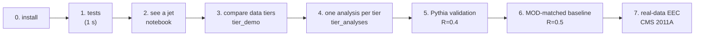
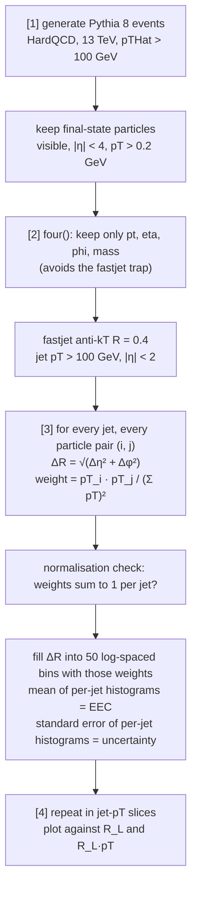

# Walkthrough — from installation to Pythia validation and real data

*[한국어판: GUIDE.md](GUIDE.md). The two versions have the same content; if they disagree, the
Korean one is the original.*

This guide is written so that someone new to the repository can reproduce **the same numbers and
the same figures**. Every step lists:

- **What it does**: what actually happens inside the script
- **Reading the output**: the real output, and what each line means
- **Pass criterion**: what must come out before you move on

All outputs below were copied from a run on 2026-11-05 in a **fresh clone with an empty virtual
environment**. With the same seed the numbers must agree to the last printed digit. If they
don't, something changed.

> Physics background (jets, EEC, data tiers) is in the [README](../README.md). The reference
> numbers are in [tier_analyses_results.md](tier_analyses_results.md) and
> [pythia_validation_results.md](pythia_validation_results.md).

---

## Overview



Steps 1–4 use **synthetic (toy) events** to learn the code and the concepts. Steps 5–6 use a
**real physics model (Pythia 8)** to prove the pipeline is correct. Step 7 is the first to use
**real collision data**. If an earlier step does not pass, a strange result later cannot be
attributed to the code or to the data, so **do not skip steps.**

| step | command | time (1 core) | network |
|---|---|---|---|
| 0 | `pip install -r requirements.txt` | 20 s | PyPI |
| 1 | `python -m pytest -q tests` | 2 s | none |
| 2 | `make_sample.py` → notebook | 1 s + 3 s notebook | none |
| 3 | `tier_demo.py` | 2 s | none |
| 4 | `tier_analyses.py` | 6 s | none |
| 5 | `validate_eec_pythia.py` | 15 s (2k) to 2 min (10k + comparison) | none |
| 6 | `validate_eec_pythia.py --preset mod2011` | 6 min | none |
| 7 | `analyze_mod.py` | not yet measured | **zenodo.org** |

---

## 0. Installation

### Option A — pip (verified, simplest)

Checked on Python 3.13.

```bash
git clone https://github.com/NhWee/Jet_analysis_beginner.git
```

```bash
cd Jet_analysis_beginner
```

```bash
python -m venv .venv
```

```bash
source .venv/bin/activate
```

On Windows PowerShell use `.venv\Scripts\Activate.ps1`.

```bash
pip install -r requirements.txt
```

**What it does.** Installs the exact versions listed in `requirements.txt`. Versions are pinned
because a different fastjet or awkward version can change results **silently**.

| package | role here |
|---|---|
| `numpy`, `scipy` | numerics |
| `awkward` | "jagged" arrays: a different number of particles per event |
| `vector` | four-vectors (pT, η, φ, mass) |
| `fastjet` | jet clustering (anti-kT) |
| `uproot` | read/write ROOT files without installing ROOT |
| `matplotlib`, `mplhep` | plots, experiment styles |
| `pythia8mc` | Pythia 8 event generator (PyPI build) |
| `energyflow`, `h5py` | reading the CMS 2011A MOD data |
| `pytest` | tests |

**Check:**

```bash
python -c "import awkward, fastjet, vector, uproot, energyflow, pythia8mc; print('ok')"
```

It should print `ok`.

### Option B — conda (full stack: PyTorch, coffea, JupyterLab)

```bash
mamba env create -f environment.yml
```

```bash
conda activate jet-eec
```

**To match every version exactly** (linux-64 only), use `environment.lock.yml` instead of `environment.yml`:

```bash
mamba env create -f environment.lock.yml
```

**Check:**

```bash
python -c "import awkward, fastjet, vector, uproot, energyflow, pythia8mc, torch, coffea; print('ok')"
```

**Verification.** On 2026-11-05 `environment.yml` was built with micromamba 2.10.0 and steps
1–6 were run. Tests, every script and the notebook passed, and the outputs of `tier_analyses.py`
and the Pythia validation were **identical (by diff) to the pip route** (at 2000 events; the same holds for a fresh environment built from `environment.lock.yml`).

Two things were fixed while verifying (written down so nobody falls into them again):

- **Python 3.13 is used.** On 3.11 the prebuilt wheel of `wasserstein`, pulled in by
  `energyflow`, requires numpy < 2. The pip stage then downgrades conda's numpy to 1.26 and
  `import pandas` breaks. Creating the environment still "succeeds" without an error, so you only
  find out when you use it.
- **Pythia comes from PyPI (`pythia8mc`), not conda-forge.** The conda-forge build (8.312) is a
  different version from PyPI (8.318) and generates different events for the same seed (1828 vs
  1785 jets in 2000 events), so the reproduction checklist below would not match.

Do not skip `conda activate jet-eec`. Putting the environment on PATH without activating it
leaves the environment variables that packages rely on unset.

### Option C — Docker

```bash
docker build -t jet-eec .
```

```bash
docker run -it --rm -p 8888:8888 -v "$PWD":/work jet-eec
```

---

## 1. Tests — is the code intact?

```bash
python -m pytest -q tests
```

**What it does.** Runs 31 small checks. They use only the toy generator and a few hand-written
particles, with no data and no Pythia. They protect the properties of this project that must
never break.

| file | what it checks |
|---|---|
| `tests/test_eec.py` | EEC weights sum to exactly 1, a hand-computed two-particle jet, angles across φ = ±π, chunked = unchunked, the definition of the statistical error, pT slicing, jet weights |
| `tests/test_jets.py` | **regression test for the fastjet trap**: extra fields such as `charge` must not change the jets; constituents sum to the jet; cuts applied; selecting the N hardest jets |
| `tests/test_mod.py` | conversion of MOD-format particles: pileup removal (CHS), charged selection, rapidity → pseudorapidity |

**Output:**

```
...............................                                          [100%]
31 passed in 1.43s
```

**Pass criterion:** `31 passed`. If any `F` appears, **do not continue.**

---

## 2. Seeing a jet — practice ROOT file and notebook

### 2-1. Make the practice file

```bash
python src/make_sample.py
```

**What it does.** Generates 200 events with `src/toy_generator.py` and writes them in the same
format as real experiment data: a ROOT TTree with a particle list per event. **This is not real
collision data.**

**Output:**

```
이벤트 200개 생성 중 (seed=12345) ...
저장: data/raw/sample_events.root  (356 kB)
이벤트당 평균 입자 수: 77
```

(The script prints in Korean: "generating 200 events", "saved", "mean particles per event: 77".)

### 2-2. Look inside the file

```bash
python src/inspect_file.py data/raw/sample_events.root --grep pt
```

**What it does.** Lists the variables (branches) in a ROOT file. Variable names differ between
experiments and releases, so **always run this first on any new data**. It also opens URLs
directly.

**Output:**

```
=== TTree: Events;1 ===
  이벤트 수: 200
  'pt' 를 포함하는 변수: 1개

    Particle_pt  std::vector<double>
```

`std::vector<double>` means "a list of numbers whose length differs per event".

### 2-3. Notebook

```bash
pip install jupyterlab
```

```bash
jupyter lab notebooks/01_what_is_a_jet.ipynb
```

**What it does.** Plots one event's particles in the η–φ plane so you can **see the clusters**,
finds them with the anti-kT algorithm to make jets, then opens one jet to look at its
constituents. Run `make_sample.py` first. Verified to run top to bottom without errors. The
notebook text is in Korean.

---

## 3. Comparing data tiers — "which data do I need?"

```bash
python src/tier_demo.py --n-events 400 --seed 12345
```

**What it does.**

1. Writes the same toy events into three ROOT files that mimic three CMS data formats
   (`data/interim/tier_demo/`):
   - NanoAOD: jet four-vectors only
   - PFNano: plus the particles inside each jet
   - AOD: every particle in the event and no jets; you cluster yourself
2. Tries five analyses on each file and tabulates **what works and what does not**.

The events are identical; only the stored information differs. That makes concrete what is lost
when information is dropped.

**Output (excerpt):**

```
Capability matrix
                            NanoAOD     PFNano      AOD
  Jet pT spectrum           YES         YES         YES
  Dijet mass                YES         YES         YES
  Constituent multiplicity  NO          YES         YES
  EEC                       NO          YES         YES
  Recluster at R=0.8        NO          NO          YES
```

**Reading it.** The EEC, which is this project's target, needs **the particles inside the jet**,
so it is impossible with NanoAOD. Reclustering at another radius (R = 0.8) needs particles
outside the original jet too. So it fails with PFNano and needs AOD (or MiniAOD).

---

## 4. One analysis per tier

```bash
python src/tier_analyses.py --n-events 2000 --seed 12345
```

**What it does.** Generates 2000 toy events and runs, end to end, the analysis each tier
permits.

| tier | what the script does |
|---|---|
| NanoAOD | power-law fit to the jet pT spectrum, χ distribution from the dijet rapidity difference, 3-jet/2-jet ratio R₃₂ |
| PFNano | fragmentation function D(z), constituent multiplicity, girth, pTD, **EEC** |
| MiniAOD | `compress()`: 0.3 GeV pT threshold plus angles rounded to 10⁻³ (mimics MiniAOD packing). R scan 0.2–1.0, trimming (drop soft subjets), charged-only EEC |
| AOD | `apply_tracking()`: drop 5–10% of charged particles (tracking efficiency) or smear their angles by 2 mrad (resolution), and see how the EEC moves → systematic uncertainty |

**Output (excerpt):**

```
=== NanoAOD :: jet kinematics only ===
  jets                    : 3237
  spectrum index n        : 4.85   (dN/dpT ~ pT^-n; input was 5.0)
  R32 = N3/N2             : 0.151   (alpha_s-sensitive in real data)

=== PFNano :: jets + in-jet constituents ===
  <n_constituents>        : 14.8
  EEC normalisation       : 1.000000  (must be 1.0)
```

**Reading it.**
- `spectrum index n = 4.85 (input was 5.0)`: the generator was given 5.0 and 4.85 came back. This
  is not a bug. Jets are reconstructed, so they migrate across the pT threshold, and the
  acceptance cut sculpts the shape. In real data, unfolding corrects for this.
- `EEC normalisation : 1.000000`: **the most important number.** See step 5.

**Pass criterion:** the numbers match [tier_analyses_results.md](tier_analyses_results.md) to the
last digit. The figures are rewritten to `results/figures/tier_*.png`.

---

## 5. Pythia validation — is the pipeline correct? (required before real data)

```bash
python src/validate_eec_pythia.py --n-events 2000 --seed 12345
```

From here on the input is **Pythia 8**, not toy. It has real QCD matrix elements, a parton
shower and a hadronisation model, so for the first time the shapes mean something physically.

### What happens inside the script



**Why each step is the way it is.**

- **Why strip fields with `four()`.** Passing an array with extra fields such as `charge` to
  fastjet gives **wrong jets with no error**. In this repository jets were once off by up to
  168 GeV in pT and 502 GeV in mass. `tests/test_jets.py` prevents a recurrence.
- **Why the normalisation is exactly 1.** Summing all pairs including self-pairs (i = j) gives
  (Σ pTᵢ)² / (Σ pTₖ)² = 1. That is arithmetic, not physics. So anything other than 1 means the
  particle list or the weights are wrong, **before any physics is looked at**.
- **Why errors are computed per jet.** Pairs in the same jet are not independent (one particle
  enters many pairs), so a √N over pairs underestimates the error. The script builds one
  histogram per jet and takes the error from the spread between jets.
- **Why also plot against R_L·pT.** Hadronisation sets in at R_L ~ Λ_QCD / pT. Plotted against
  R_L·pT, that point should line up across different pT.

### Reading the output

```
      config: ecm=13000 R=0.4 jet pT>100 |eta|<2.0 leading=all pTHatMin=100 bias_pow=0.0
[1/4] generating 2000 Pythia events (seed=12345) ...
      2000 events, <multiplicity> = 269.2
[2/4] clustering jets ...
      1785 jets (effective 1785), <pT> = 139.2 GeV, <n_const> = 26.8
[3/4] computing EEC ...
      normalisation = 1.000000 (expect 1.0)
      EEC peak at R_L = 0.102
      figure -> results/figures/eec_pythia_validation.png
      table  -> results/tables/eec_pythia.npz
[4/4] EEC in jet-pT slices ...
      pT slice [GeV]   jets  (eff)   peak R_L   peak R_L*<pT> [GeV]   median rel. err
        100-150      1330   1330      0.102           12.3              6.5%
        150-200       318    318      0.051            8.6             11.8%
        200-300       117    117      0.045           10.5             17.4%
        300-500        18     18      0.017            6.1             33.6%
      figure -> results/figures/eec_pythia_pt_slices.png

RESULT: PASS
```

| line | meaning |
|---|---|
| `<multiplicity> = 269.2` | final-state particles per event, mostly soft particles outside jets |
| `1785 jets (effective 1785)` | jets passing the cuts; in brackets the weighted effective count (same here, no weights) |
| `<n_const> = 26.8` | mean number of particles in a jet |
| `normalisation = 1.000000` | **the pass criterion.** Anything else is FAIL |
| `peak R_L` | the angle where the EEC is highest; should shrink as pT rises |
| `peak R_L*<pT>` | the same times the mean pT; should be similar across slices |
| `median rel. err` | median relative statistical error; larger in slices with few jets |
| `results/tables/*.npz` | numbers read by the real-data comparison; not committed |

**Pass criterion:** `RESULT: PASS` (normalisation = 1.000000). With 2000 events the high-pT
slice has few jets (18), hence the large error. The numbers in the results document use 10000
events.

### Comparing with hadronisation switched off

```bash
python src/validate_eec_pythia.py --n-events 10000 --seed 12345 --compare-hadronisation
```

**What it does.** Generates the same seed again with `HadronLevel:all = off`, so jets consist of
quarks and gluons instead of hadrons. Comparing the **shapes** of the two EECs shows directly
where the small-angle weight comes from. About 2 minutes.

```
      binned EEC area (1 - self-pairs - out of range): hadron 0.876, parton 0.621
      shape ratio parton/hadron, 0.1 < R_L < R : 1.19  (perturbative region)
      shape ratio parton/hadron, R_L < 0.01    : 0.28  (hadronisation region)
```

**Reading it.** Below R_L = 0.01 the parton-level shape is 0.28× the hadron-level one: the
small-angle EEC is produced by hadronisation.

> ⚠️ **Do not divide the raw curves.** The EEC sums to 1 including the self-pairs at ΔR = 0,
> which fall outside the bins. Parton jets have few particles (~8), so their self-pair share
> (Σz²) is large and every visible bin is lower (`binned EEC area` 0.62 vs 0.88). The script
> therefore compares **shapes** renormalised over a common range. The same holds whenever samples
> with different particle multiplicity are compared: charged-only vs all, data vs MC.

---

## 6. Pythia baseline matched to the MOD dataset

```bash
python src/validate_eec_pythia.py --preset mod2011 --n-events 40000 --seed 12345 --compare-hadronisation
```

**What it does.** Builds a Pythia baseline under **the same conditions** as the real data of step
7. `--preset mod2011` sets all of the following.

| setting | value | why |
|---|---|---|
| collision energy | 7 TeV | LHC in 2011 |
| jets | anti-kT **R = 0.5** | the jets stored in the MOD data |
| selection | the **two hardest jets** per event first, then pT > 375 GeV, \|η\| < 1.9 | as in the MOD dataset and its paper (arXiv:1908.08542) |
| generator cut | pTHat > 150 GeV + **biased generation** | see below |
| pT slices | 375 / 450 / 550 / 700 / 1000 GeV | |

**Why a pTHat cut of 150 and not 375.** An R = 0.5 jet absorbs surrounding radiation and often
comes out harder than the hard scatter (pTHat). A direct check found that **8.5% of jets above
375 GeV came from pTHat < 300**. These are jets with a lot of radiation, so dropping them changes
the EEC. But with a low cut most events never reach 375 GeV. Pythia's `bias2Selection`
therefore generates high pTHat more often, and **each event carries a weight** to compensate.
`effective` in the output is the weighted effective number of jets.

**Output (excerpt):**

```
      config: ecm=7000 R=0.5 jet pT>375 |eta|<1.9 leading=2 pTHatMin=150 bias_pow=4.0
      14785 jets (effective 5840), <pT> = 447.7 GeV, <n_const> = 42.1
      normalisation = 1.000000 (expect 1.0)
      pT slice [GeV]   jets  (eff)   peak R_L   peak R_L*<pT> [GeV]   median rel. err
        375-450      5193   3010      0.019            7.9              2.7%
        450-550      4191   2526      0.015            7.2              3.0%
        550-700      3002   1757      0.015            8.9              3.4%
        700-1000     1902   1340      0.010            7.6              4.4%
```

**Pass criterion:** `RESULT: PASS`. In the right panel of
`results/figures/eec_pythia_pt_slices_mod2011.png` the left (small-angle) parts of all four
curves must fall on one curve. This run writes `results/tables/eec_pythia_mod2011.npz`, which
step 7 reads. **Always run this step before step 7.**

---

## 7. First real-data EEC — CMS 2011A Open Data

> **Status: the code is ready and tested, but it has never been run on the real data yet,**
> because the network of the environment where it was written blocked zenodo.org. That is why
> there is no expected output below. Whoever runs it first: add the result to
> [pythia_validation_results.md](pythia_validation_results.md).

```bash
python src/analyze_mod.py --n-files 1
```

**The data.** The CMS 2011A Jet primary dataset, reprocessed by the MIT group into HDF5 with only
jets and their particles (PF candidates).
[Zenodo 10.5281/zenodo.3340205](https://doi.org/10.5281/zenodo.3340205), CC BY 4.0. 1,785,625
jets in 18 files of about 111 MB each. Read with `energyflow`, no CMSSW needed.

**What it does.**

1. `energyflow` downloads one file from Zenodo into `data/raw/mod/` and **checks its md5**.
   Later runs reuse the downloaded file.
2. Same selection as the original paper: JEC-corrected pT > 375 GeV, |η| < 1.9, jet quality
   medium or better.
3. Particle cleaning:
   - **CHS**: drop charged particles from pileup vertices (other collisions in the same bunch
     crossing).
   - **rapidity → pseudorapidity**: MOD stores rapidity (y), while this pipeline and the Pythia
     baseline use pseudorapidity (η). They differ for massive particles, and mixing them would
     distort small-angle distances, so the script converts.
4. Uses **the same functions** as step 5 for the normalisation check, the pT-sliced EEC and the
   charged-only EEC.
5. Compares the shape with the step-6 Pythia table and prints data/Pythia ratios per region.

**Products:** `results/figures/eec_mod2011_data_pt_slices.png`,
`results/figures/eec_mod2011_data_vs_pythia.png`.

**Pass criterion:** `normalisation = 1.000000`. If it is not 1 on real data, the particle
conversion is wrong.

**Interpretation.** This compares **detector-level data with generator-level MC**, with no
unfolding and no systematic uncertainties. Differences at small angle can come from detector
resolution and reconstruction thresholds. It is a first look, not a measurement. A like-for-like
comparison uses the MOD SIM sample (Pythia 6 + CMS detector simulation).

**If you downloaded the file yourself:**

```bash
python src/analyze_mod.py --files data/raw/mod/CMS_Jet300_pT375-infGeV_0_compressed.h5
```

---

## Reproduction checklist

With seed 12345 these numbers must agree. If any differs, the environment or the code changed.

| step | command | numbers to check |
|---|---|---|
| 1 | `pytest -q tests` | `31 passed` |
| 4 | `tier_analyses.py --n-events 2000` | jets 3237, n 4.85, R₃₂ 0.151, ⟨n_const⟩ 14.8, trimming −18.8% |
| 5 | `validate_eec_pythia.py --n-events 2000` | 1785 jets, ⟨pT⟩ 139.2, ⟨n_const⟩ 26.8, peak 0.102 |
| 5 | `... --n-events 10000 --compare-hadronisation` | 9129 jets, shape ratios 1.19 / 0.28 |
| 6 | `--preset mod2011 --n-events 40000` | 14785 jets (effective 5840), ⟨pT⟩ 447.7 |
| all | | `normalisation = 1.000000` |

---

## Common problems

| symptom | cause | fix |
|---|---|---|
| `ModuleNotFoundError: No module named 'uproot'` (or another package) | virtual environment not active, or not installed | `source .venv/bin/activate`, then `pip install -r requirements.txt` |
| `No module named 'pythia8'` | the PyPI build is called `pythia8mc` | the scripts try both; only matters when importing it yourself |
| `Pythia initialisation failed` (preceded by `unmatched version numbers` / `unknown key`) | Pythia cannot find its XML data. The conda-forge build sets `PYTHIA8DATA` only when the environment is **activated** | `conda activate jet-eec`, or `PYTHIA8DATA=<prefix>/share/Pythia8/xmldoc` |
| Pythia numbers in a conda environment differ from the checklist | the conda-forge `pythia8` is installed (different version) | recreate the environment from the current `environment.yml` (PyPI `pythia8mc==8.318.3`) |
| `import pandas` fails in a conda environment | a Python 3.11 environment (numpy downgrade) | recreate it from the current `environment.yml` (Python 3.13) |
| notebook prints `존재함: False` ("exists: False") | practice file missing | run `python src/make_sample.py` first |
| `analyze_mod.py` hangs on download or gets 403 | network blocks zenodo.org | in a cloud environment, add `zenodo.org` to Allowed domains and start a **new session**; or download in a browser and pass `--files` |
| step 7 says "no Pythia table" | step 6 not run (tables are not committed) | run step 6 first |
| after a run, `git status` shows modified `results/figures/*.png` | redrawing changes the bytes slightly | normal if the numbers match; restore with `git checkout results/figures` |
| numbers differ slightly on another machine | package versions | use the exact versions in `requirements.txt` |
| jets look wrong in your own code | extra fields passed to fastjet | keep only pt/eta/phi/mass with `jeteec.jets.four()` before clustering |

---

## Further reading

- [README](../README.md): physics background (EEC definition, meaning of the angular regions) and data tiers
- [ROADMAP.md](ROADMAP.md): where the project is and what comes next (Korean)
- [WORKFLOW.md](WORKFLOW.md): commit rules, what goes to GitHub vs Notion (Korean)
- The header comment of `src/jeteec/eec.py`: EEC normalisation and pair-counting conventions; read before comparing with any paper
