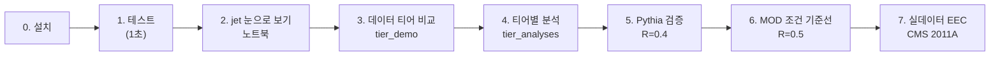
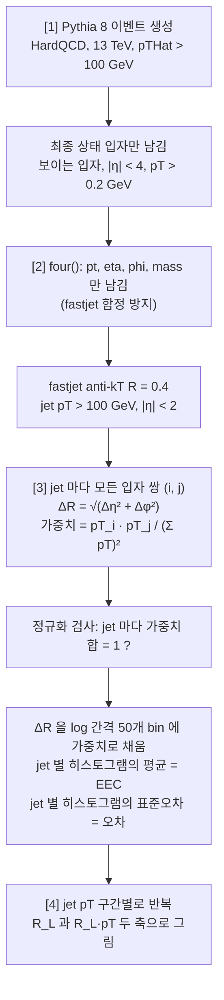

# 따라 하기 가이드 — 설치부터 Pythia 검증, 실데이터까지

*[English version: GUIDE.en.md](GUIDE.en.md)*

이 문서만 보고 처음 보는 사람이 **같은 숫자와 같은 그림**을 재현할 수 있게 쓴 안내서다.
명령마다 세 가지를 적었다.

- **무엇을 하나**: 스크립트 안에서 실제로 일어나는 과정
- **출력 읽는 법**: 실제로 돌렸을 때 나온 출력과 각 줄의 의미
- **통과 기준**: 무엇이 나와야 다음 단계로 가도 되는가

아래 출력은 모두 2026-11-05 에 **새로 clone 한 저장소 + 빈 가상환경**에서 실제로 돌린 결과를
그대로 옮긴 것이다. seed 가 같으면 숫자가 소수점까지 같아야 한다. 다르면 무언가 바뀐 것이다.

> 물리 배경(jet, EEC, 데이터 티어)은 [README](../README.md) 에, 결과 수치의 정본은
> [tier_analyses_results.md](tier_analyses_results.md) 와
> [pythia_validation_results.md](pythia_validation_results.md) 에 있다.

---

## 전체 흐름



1–4 단계는 **흉내낸 데이터(toy)** 로 코드와 개념을 익히는 단계다. 5–6 단계는 **진짜 물리
모델(Pythia 8)** 로 파이프라인이 맞는지 증명한다. 7 단계에서 처음으로 **실제 충돌 데이터**를
쓴다. 앞 단계가 통과하지 않으면 다음 단계의 이상한 결과가 코드 탓인지 데이터 탓인지
구분할 수 없으므로 **순서를 건너뛰지 않는다.**

| 단계 | 명령 | 시간 (1코어) | 네트워크 |
|---|---|---|---|
| 0 | `pip install -r requirements.txt` | 20초 | PyPI |
| 1 | `python -m pytest -q tests` | 2초 | 불필요 |
| 2 | `make_sample.py` → 노트북 | 1초 + 노트북 3초 | 불필요 |
| 3 | `tier_demo.py` | 2초 | 불필요 |
| 4 | `tier_analyses.py` | 6초 | 불필요 |
| 5 | `validate_eec_pythia.py` | 15초 (2k) ~ 2분 (10k + 비교) | 불필요 |
| 6 | `validate_eec_pythia.py --preset mod2011` | 6분 | 불필요 |
| 7 | `analyze_mod.py` | 미측정 | **zenodo.org** |

---

## 0. 설치

### 방법 A — pip (검증됨, 가장 간단)

Python 3.13 에서 확인했다.

```bash
git clone https://github.com/NhWee/Jet_analysis_beginner.git
```

```bash
cd Jet_analysis_beginner
```

```bash
python -m venv .venv
```

```bash
source .venv/bin/activate
```

Windows PowerShell 에서는 `.venv\Scripts\Activate.ps1` 이다.

```bash
pip install -r requirements.txt
```

**무엇을 하나.** `requirements.txt` 에 적힌 정확한 버전을 설치한다. 버전을 고정하는 이유는
fastjet 이나 awkward 버전이 바뀌면 결과가 **오류 없이 조용히** 달라질 수 있기 때문이다.

| 패키지 | 이 프로젝트에서 하는 일 |
|---|---|
| `numpy`, `scipy` | 수치 계산 |
| `awkward` | 이벤트마다 입자 수가 다른 "들쭉날쭉한" 배열 |
| `vector` | 4-벡터 (pT, η, φ, 질량) 연산 |
| `fastjet` | jet 클러스터링 (anti-kT) |
| `uproot` | ROOT 파일 읽기/쓰기, ROOT 설치 없이 |
| `matplotlib`, `mplhep` | 그림, 실험 스타일 |
| `pythia8mc` | Pythia 8 이벤트 생성기 (PyPI 판) |
| `energyflow`, `h5py` | CMS 2011A MOD 데이터 읽기 |
| `pytest` | 테스트 |

**확인:**

```bash
python -c "import awkward, fastjet, vector, uproot, energyflow, pythia8mc; print('ok')"
```

`ok` 가 나오면 된다.

### 방법 B — conda (전체 환경: PyTorch, coffea, JupyterLab 포함)

```bash
mamba env create -f environment.yml
```

```bash
conda activate jet-eec
```

conda-forge 판 Pythia 는 `import pythia8` 이고 PyPI 판은 `import pythia8mc` 다. 스크립트는
둘 다 시도하므로 어느 쪽이든 된다. 이 경로는 이 문서를 쓴 환경에서 직접 검증하지 못했다.

### 방법 C — Docker

```bash
docker build -t jet-eec .
```

```bash
docker run -it --rm -p 8888:8888 -v "$PWD":/work jet-eec
```

---

## 1. 테스트 — 코드가 망가지지 않았나

```bash
python -m pytest -q tests
```

**무엇을 하나.** 31개의 작은 검사를 돌린다. 데이터나 Pythia 없이 toy 생성기와 손으로 만든
입자 몇 개만 쓴다. 이 프로젝트에서 "절대 깨지면 안 되는 성질"을 지킨다.

| 파일 | 검사하는 것 |
|---|---|
| `tests/test_eec.py` | EEC 가중치 합 = 정확히 1, 손으로 계산한 2입자 jet 값, φ 가 ±π 를 넘을 때의 각도 계산, 나눠 계산해도 결과 동일, 통계 오차 정의, pT 구간 나누기, jet 가중치 |
| `tests/test_jets.py` | **fastjet 함정 재발 방지**: `charge` 같은 추가 필드가 붙어도 jet 이 같아야 함, constituent 합 = jet, 컷 적용, 가장 센 N개 jet 선택 |
| `tests/test_mod.py` | MOD 형식 입자 → 파이프라인 형식 변환: pileup 제거(CHS), charged 선택, rapidity → pseudorapidity |

**출력:**

```
...............................                                          [100%]
31 passed in 1.43s
```

**통과 기준:** `31 passed`. 하나라도 `F` 가 나오면 **다음 단계로 가지 않는다.**

---

## 2. jet 을 눈으로 보기 — 연습용 ROOT 파일과 노트북

### 2-1. 연습용 파일 만들기

```bash
python src/make_sample.py
```

**무엇을 하나.** `src/toy_generator.py` 로 이벤트 200개를 만들어 실제 실험 데이터와 같은
형식(이벤트마다 입자 목록이 든 ROOT TTree)으로 저장한다. **실제 충돌 데이터가 아니다.**

**출력:**

```
이벤트 200개 생성 중 (seed=12345) ...
저장: data/raw/sample_events.root  (356 kB)
이벤트당 평균 입자 수: 77
```

### 2-2. 파일 안 들여다보기

```bash
python src/inspect_file.py data/raw/sample_events.root --grep pt
```

**무엇을 하나.** ROOT 파일에 어떤 변수(branch)가 있는지 보여준다. 실험마다, 릴리스마다 변수
이름이 다르므로 **새 데이터를 받으면 분석 전에 항상 이것부터** 돌린다. URL 도 직접 연다.

**출력:**

```
=== TTree: Events;1 ===
  이벤트 수: 200
  'pt' 를 포함하는 변수: 1개

    Particle_pt  std::vector<double>
```

`std::vector<double>` 는 "이벤트마다 길이가 다른 숫자 목록"이라는 뜻이다.

### 2-3. 노트북

```bash
pip install jupyterlab
```

```bash
jupyter lab notebooks/01_what_is_a_jet.ipynb
```

**무엇을 하나.** 한 이벤트의 입자를 η–φ 평면에 찍어 **뭉쳐 있는 것**을 눈으로 보고, 그것을
anti-kT 알고리즘으로 찾아내 jet 을 만든 다음, jet 하나를 열어 constituent 를 확인한다.
`make_sample.py` 를 먼저 돌려야 한다. 처음부터 끝까지 오류 없이 실행되는 것을 확인했다.

---

## 3. 데이터 티어 비교 — "어떤 데이터가 필요한가"

```bash
python src/tier_demo.py --n-events 400 --seed 12345
```

**무엇을 하나.**

1. 같은 toy 이벤트를 CMS 데이터 형식 셋을 흉내낸 ROOT 파일 셋으로 저장한다
   (`data/interim/tier_demo/`).
   - NanoAOD: jet 4-벡터만
   - PFNano: + jet 안의 입자
   - AOD: 이벤트의 모든 입자, jet 은 없음 — 직접 클러스터링
2. 각 파일로 분석 5가지를 시도해서 **무엇이 되고 무엇이 안 되는지** 표로 보여준다.

같은 이벤트인데 저장된 정보만 다르다. 그래서 정보가 줄면 무엇을 잃는지가 구체적으로 보인다.

**출력 (일부):**

```
Capability matrix
                            NanoAOD     PFNano      AOD
  Jet pT spectrum           YES         YES         YES
  Dijet mass                YES         YES         YES
  Constituent multiplicity  NO          YES         YES
  EEC                       NO          YES         YES
  Recluster at R=0.8        NO          NO          YES
```

**읽는 법.** 이 프로젝트의 목표인 EEC 는 **jet 안의 입자가 있어야** 계산된다. 그래서
NanoAOD 로는 불가능하다. 다른 반경(R=0.8)으로 다시 묶으려면 jet 밖의 입자까지 필요하다.
그래서 PFNano 로도 안 되고 AOD(또는 MiniAOD)가 필요하다.

---

## 4. 티어별 분석 — 각 형식으로 할 수 있는 실제 분석

```bash
python src/tier_analyses.py --n-events 2000 --seed 12345
```

**무엇을 하나.** toy 이벤트 2000개를 만들고, 각 티어가 허용하는 분석을 하나씩 끝까지 돌린다.

| 티어 | 스크립트가 하는 일 |
|---|---|
| NanoAOD | jet pT 스펙트럼에 거듭제곱 함수를 fit, 두 jet 의 rapidity 차이로 χ 분포, 3-jet/2-jet 비율 R₃₂ |
| PFNano | 파편화 함수 D(z), constituent 수, girth, pTD, **EEC** |
| MiniAOD | `compress()`: pT 0.3 GeV 문턱 + 각도를 10⁻³ 단위로 반올림 (MiniAOD 압축 흉내). R = 0.2–1.0 스캔, trimming(작은 subjet 제거), charged 입자만으로 EEC |
| AOD | `apply_tracking()`: charged 입자를 5–10% 버리거나(추적 효율) 각도를 2 mrad 흔들어(분해능) EEC 가 얼마나 변하는지 → 체계 오차 |

**출력 (일부):**

```
=== NanoAOD :: jet kinematics only ===
  jets                    : 3237
  spectrum index n        : 4.85   (dN/dpT ~ pT^-n; input was 5.0)
  R32 = N3/N2             : 0.151   (alpha_s-sensitive in real data)

=== PFNano :: jets + in-jet constituents ===
  <n_constituents>        : 14.8
  EEC normalisation       : 1.000000  (must be 1.0)
```

**읽는 법.**
- `spectrum index n = 4.85 (input was 5.0)`: 생성할 때 5.0 을 넣었는데 4.85 가 나왔다. 버그가
  아니다. jet 은 재구성된 것이라 pT 문턱 근처에서 넘나들고(migration) 검출 범위 컷이 모양을
  깎는다. 실데이터에서는 unfolding 이 이것을 보정한다.
- `EEC normalisation : 1.000000`: **가장 중요한 숫자.** 아래 5단계 설명 참고.

**통과 기준:** 숫자가 [tier_analyses_results.md](tier_analyses_results.md) 와 소수점까지 같다.
그림은 `results/figures/tier_*.png` 에 다시 쓰인다.

---

## 5. Pythia 검증 — 파이프라인이 옳은가 (실데이터 전 필수)

```bash
python src/validate_eec_pythia.py --n-events 2000 --seed 12345
```

여기서부터는 toy 가 아니라 **Pythia 8** 이다. 실제 QCD 행렬 원소, 파톤 샤워, 강입자화 모델을
가진 생성기라서 처음으로 물리적으로 의미 있는 모양이 나온다.

### 스크립트 안에서 일어나는 일



**각 단계가 왜 그렇게 되어 있나.**

- **`four()` 로 필드를 줄이는 이유.** `charge` 같은 추가 필드가 붙은 배열을 fastjet 에 넘기면
  **오류 없이 틀린 jet** 이 나온다. 이 저장소에서 실제로 pT 168 GeV, 질량 502 GeV 까지
  어긋난 적이 있다. `tests/test_jets.py` 가 재발을 막는다.
- **정규화가 정확히 1 인 이유.** 자기 자신과의 쌍(i = j)까지 포함해 모든 쌍을 더하면
  (Σ pTᵢ)² / (Σ pTₖ)² = 1 이다. 물리와 무관한 산수다. 그래서 1 이 아니면 **물리를 보기 전에**
  입자 목록이나 가중치가 틀렸다는 뜻이다.
- **오차를 jet 단위로 계산하는 이유.** 같은 jet 안의 쌍들은 서로 독립이 아니다(입자 하나가
  여러 쌍에 들어간다). 그래서 쌍 단위로 √N 을 쓰면 오차가 과소평가된다. jet 마다 히스토그램을
  만들고 jet 들 사이의 흩어짐으로 오차를 잡는다.
- **R_L·pT 축으로도 그리는 이유.** 강입자화가 시작되는 각도는 R_L ~ Λ_QCD / pT 다. 그래서
  R_L·pT 로 그리면 pT 가 달라도 그 지점이 한 자리에 겹쳐야 한다.

### 출력 읽는 법

```
      config: ecm=13000 R=0.4 jet pT>100 |eta|<2.0 leading=all pTHatMin=100 bias_pow=0.0
[1/4] generating 2000 Pythia events (seed=12345) ...
      2000 events, <multiplicity> = 269.2
[2/4] clustering jets ...
      1785 jets (effective 1785), <pT> = 139.2 GeV, <n_const> = 26.8
[3/4] computing EEC ...
      normalisation = 1.000000 (expect 1.0)
      EEC peak at R_L = 0.102
      figure -> results/figures/eec_pythia_validation.png
      table  -> results/tables/eec_pythia.npz
[4/4] EEC in jet-pT slices ...
      pT slice [GeV]   jets  (eff)   peak R_L   peak R_L*<pT> [GeV]   median rel. err
        100-150      1330   1330      0.102           12.3              6.5%
        150-200       318    318      0.051            8.6             11.8%
        200-300       117    117      0.045           10.5             17.4%
        300-500        18     18      0.017            6.1             33.6%
      figure -> results/figures/eec_pythia_pt_slices.png

RESULT: PASS
```

| 줄 | 의미 |
|---|---|
| `<multiplicity> = 269.2` | 이벤트당 최종 상태 입자 수. 대부분은 jet 밖의 부드러운 입자 |
| `1785 jets (effective 1785)` | 컷을 통과한 jet 수. 괄호 안은 가중치를 고려한 유효 개수(여기선 가중치가 없어 같음) |
| `<n_const> = 26.8` | jet 하나에 든 평균 입자 수 |
| `normalisation = 1.000000` | **통과 기준.** 1 이 아니면 FAIL |
| `peak R_L` | EEC 가 가장 높은 각도. pT 가 올라갈수록 작아져야 한다 |
| `peak R_L*<pT>` | 위 값에 평균 pT 를 곱한 것. pT 구간이 달라도 비슷해야 한다 |
| `median rel. err` | 상대 통계 오차의 중앙값. jet 수가 적은 구간일수록 크다 |
| `results/tables/*.npz` | 다음 단계(실데이터 비교)에서 읽는 숫자 표. 커밋하지 않는다 |

**통과 기준:** `RESULT: PASS` (정규화 = 1.000000). 2000 이벤트로는 높은 pT 구간의 jet 이
적어서(18개) 오차가 크다. 결과 문서의 수치는 10000 이벤트로 만든 것이다.

### 강입자화를 끄고 비교하기

```bash
python src/validate_eec_pythia.py --n-events 10000 --seed 12345 --compare-hadronisation
```

**무엇을 하나.** 같은 seed 로 `HadronLevel:all = off` 상태의 이벤트를 한 번 더 만든다. 이때
jet 은 강입자가 아니라 쿼크·글루온으로 이루어진다. 두 EEC 의 **모양**을 비교해서 작은 각도의
가중치가 어디서 오는지 직접 확인한다. 약 2분 걸린다.

```
      binned EEC area (1 - self-pairs - out of range): hadron 0.876, parton 0.621
      shape ratio parton/hadron, 0.1 < R_L < R : 1.19  (perturbative region)
      shape ratio parton/hadron, R_L < 0.01    : 0.28  (hadronisation region)
```

**읽는 법.** R_L < 0.01 에서 parton 쪽 모양이 hadron 쪽의 0.28배다. 작은 각도 쪽 EEC 는
강입자화가 만든다는 뜻이다.

> ⚠️ **두 곡선을 그대로 나누면 안 된다.** EEC 는 ΔR = 0 의 자기 쌍까지 합쳐 1 이고, 자기 쌍은
> bin 밖이라 안 보인다. parton jet 은 입자 수가 적어(~8개) 자기 쌍 몫(Σz²)이 크고, 그만큼
> 보이는 bin 이 전부 낮아진다(`binned EEC area` 0.62 vs 0.88). 그래서 스크립트는 공통 범위로
> 다시 정규화한 **모양**을 비교한다. 입자 수가 다른 샘플끼리 비교할 때는 항상 같다:
> charged-only vs 전체, data vs MC.

---

## 6. MOD 데이터셋 조건의 Pythia 기준선

```bash
python src/validate_eec_pythia.py --preset mod2011 --n-events 40000 --seed 12345 --compare-hadronisation
```

**무엇을 하나.** 7단계의 실데이터와 **같은 조건**으로 Pythia 기준선을 만든다. `--preset mod2011`
이 아래 설정을 한꺼번에 정한다.

| 설정 | 값 | 이유 |
|---|---|---|
| 충돌 에너지 | 7 TeV | 2011년 LHC |
| jet | anti-kT **R = 0.5** | MOD 데이터에 저장된 jet |
| 선택 | 이벤트당 **가장 센 jet 2개**를 먼저 고르고, 그다음 pT > 375 GeV, \|η\| < 1.9 | MOD 데이터셋과 원 논문(arXiv:1908.08542)의 방식 |
| 생성기 하한 | pTHat > 150 GeV + **편향 생성** | 아래 설명 |
| pT 구간 | 375 / 450 / 550 / 700 / 1000 GeV | |

**왜 pTHat 하한을 375 가 아니라 150 으로 두나.** R = 0.5 jet 은 주변 복사를 흡수해서 원래 충돌의
pT(pTHat)보다 세게 나오는 경우가 많다. 직접 확인해 보니 pT > 375 GeV jet 의 **8.5% 가
pTHat < 300** 에서 왔다. 이 jet 들은 복사가 많은 jet 이라 빼면 EEC 모양이 달라진다. 그런데
하한을 낮추면 대부분의 이벤트가 375 GeV 근처에도 못 간다. 그래서 Pythia 의
`bias2Selection` 으로 높은 pTHat 를 더 자주 만들고, 그 대가로 **이벤트마다 가중치**를 붙여
보정한다. 출력의 `effective` 가 가중치를 고려한 유효 jet 수다.

**출력 (일부):**

```
      config: ecm=7000 R=0.5 jet pT>375 |eta|<1.9 leading=2 pTHatMin=150 bias_pow=4.0
      14785 jets (effective 5840), <pT> = 447.7 GeV, <n_const> = 42.1
      normalisation = 1.000000 (expect 1.0)
      pT slice [GeV]   jets  (eff)   peak R_L   peak R_L*<pT> [GeV]   median rel. err
        375-450      5193   3010      0.019            7.9              2.7%
        450-550      4191   2526      0.015            7.2              3.0%
        550-700      3002   1757      0.015            8.9              3.4%
        700-1000     1902   1340      0.010            7.6              4.4%
```

**통과 기준:** `RESULT: PASS`. 그림 `results/figures/eec_pythia_pt_slices_mod2011.png` 오른쪽
패널에서 네 곡선의 왼쪽(작은 각도) 부분이 한 곡선으로 겹쳐야 한다. 이 실행에서 만든 표
`results/tables/eec_pythia_mod2011.npz` 를 7단계가 읽는다. **7단계 전에 반드시 이 단계를 돌린다.**

---

## 7. 첫 실데이터 EEC — CMS 2011A Open Data

> **현재 상태: 코드는 준비됐고 테스트를 통과했지만, 실데이터로는 아직 한 번도 돌리지 못했다.**
> 작업 환경의 네트워크가 zenodo.org 를 막았기 때문이다. 아래 출력 예시가 없는 이유다.
> 처음 돌리는 사람이 결과를 [pythia_validation_results.md](pythia_validation_results.md) 에 추가할 것.

```bash
python src/analyze_mod.py --n-files 1
```

**데이터.** CMS 2011A Jet primary dataset 을 MIT 그룹이 jet 과 그 안의 입자(PF candidate)만
뽑아 HDF5 로 재처리한 공개본이다.
[Zenodo 10.5281/zenodo.3340205](https://doi.org/10.5281/zenodo.3340205), CC BY 4.0. jet
1,785,625개, 파일 18개(각 약 111 MB). CMSSW 없이 `energyflow` 로 읽는다.

**무엇을 하나.**

1. `energyflow` 가 Zenodo 에서 파일 1개를 `data/raw/mod/` 로 받고 **md5 로 무결성을 검사**한다.
   다음부터는 받은 파일을 다시 쓴다.
2. 원 논문과 같은 선택: JEC(jet 에너지 보정) 적용 pT > 375 GeV, |η| < 1.9, jet 품질 medium 이상.
3. 입자 정리:
   - **CHS**: pileup vertex(같은 교차에서 겹친 다른 충돌)에서 온 charged 입자를 뺀다.
   - **rapidity → pseudorapidity**: MOD 는 rapidity(y)로 저장하는데, 이 파이프라인과 Pythia
     기준선은 pseudorapidity(η)를 쓴다. 질량이 있는 입자는 둘이 달라서 섞이면 작은 각도의
     거리가 어긋난다. 그래서 변환한다.
4. 5단계와 **같은 함수**로 정규화 검사, pT 구간별 EEC, charged 입자만의 EEC 를 계산한다.
5. 6단계 Pythia 표와 모양을 비교하고, 영역별 data/Pythia 비를 출력한다.

**결과물:** `results/figures/eec_mod2011_data_pt_slices.png`,
`results/figures/eec_mod2011_data_vs_pythia.png`.

**통과 기준:** `normalisation = 1.000000`. 실데이터에서도 1 이 아니면 입자 변환이 틀린 것이다.

**해석할 때 주의.** 이것은 **검출기 수준 데이터와 생성기 수준 MC 의 비교**다. unfolding 도
체계 오차도 없다. 작은 각도의 차이는 검출기 분해능과 재구성 문턱 때문에 생길 수 있다. 측정이
아니라 첫 확인이다. 데이터와 같은 수준의 비교는 MOD 의 SIM(Pythia 6 + CMS 검출기 시뮬레이션)
샘플로 해야 한다.

**파일을 직접 받은 경우:**

```bash
python src/analyze_mod.py --files data/raw/mod/CMS_Jet300_pT375-infGeV_0_compressed.h5
```

---

## 재현 확인표

seed 12345 로 돌렸을 때 반드시 같아야 하는 숫자다. 하나라도 다르면 환경이나 코드가 바뀐 것이다.

| 단계 | 명령 | 확인할 숫자 |
|---|---|---|
| 1 | `pytest -q tests` | `31 passed` |
| 4 | `tier_analyses.py --n-events 2000` | jets 3237, n 4.85, R₃₂ 0.151, ⟨n_const⟩ 14.8, trimming −18.8% |
| 5 | `validate_eec_pythia.py --n-events 2000` | 1785 jets, ⟨pT⟩ 139.2, ⟨n_const⟩ 26.8, peak 0.102 |
| 5 | `... --n-events 10000 --compare-hadronisation` | 9129 jets, 모양 비 1.19 / 0.28 |
| 6 | `--preset mod2011 --n-events 40000` | 14785 jets (effective 5840), ⟨pT⟩ 447.7 |
| 전부 | | `normalisation = 1.000000` |

---

## 자주 막히는 곳

| 증상 | 원인 | 해결 |
|---|---|---|
| `ModuleNotFoundError: No module named 'uproot'` (또는 다른 패키지) | 가상환경이 활성화되지 않았거나 설치 누락 | `source .venv/bin/activate` 후 `pip install -r requirements.txt` |
| `No module named 'pythia8'` | PyPI 판 이름은 `pythia8mc` | 스크립트가 자동으로 둘 다 시도한다. 직접 import 할 때만 주의 |
| 노트북에서 `존재함: False` | 연습용 파일이 없음 | `python src/make_sample.py` 먼저 |
| `analyze_mod.py` 가 다운로드에서 멈추거나 403 | 네트워크가 zenodo.org 를 막음 | 클라우드 환경이면 Allowed domains 에 `zenodo.org` 추가 후 **새 세션**. 또는 브라우저로 받아 `--files` |
| 7단계가 "no Pythia table" | 6단계를 안 돌림 (표는 커밋되지 않음) | 6단계 먼저 |
| 실행 후 `git status` 에 `results/figures/*.png` 가 수정됨 | 그림을 다시 그리면서 바이트가 조금 달라짐 | 숫자가 같으면 정상. `git checkout results/figures` 로 되돌린다 |
| 다른 컴퓨터에서 숫자가 미세하게 다름 | 패키지 버전 차이 | `requirements.txt` 의 정확한 버전 사용 |
| 직접 짠 코드에서 jet 이 이상함 | fastjet 에 추가 필드를 넘김 | `jeteec.jets.four()` 로 pt/eta/phi/mass 만 남긴 뒤 클러스터링 |

---

## 다음에 읽을 것

- [README](../README.md): 물리 배경(EEC 정의, 각도 영역의 의미)과 데이터 티어
- [ROADMAP.md](ROADMAP.md): 지금 어디까지 왔고 다음에 무엇을 하나
- [WORKFLOW.md](WORKFLOW.md): 커밋 규칙, GitHub 와 Notion 에 무엇을 기록하나
- `src/jeteec/eec.py` 맨 위 주석: EEC 정규화·쌍 세기 규약. 논문 숫자와 비교하기 전에 필독
