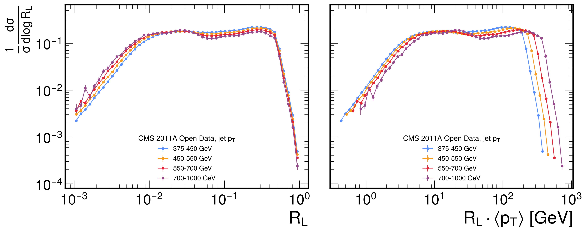
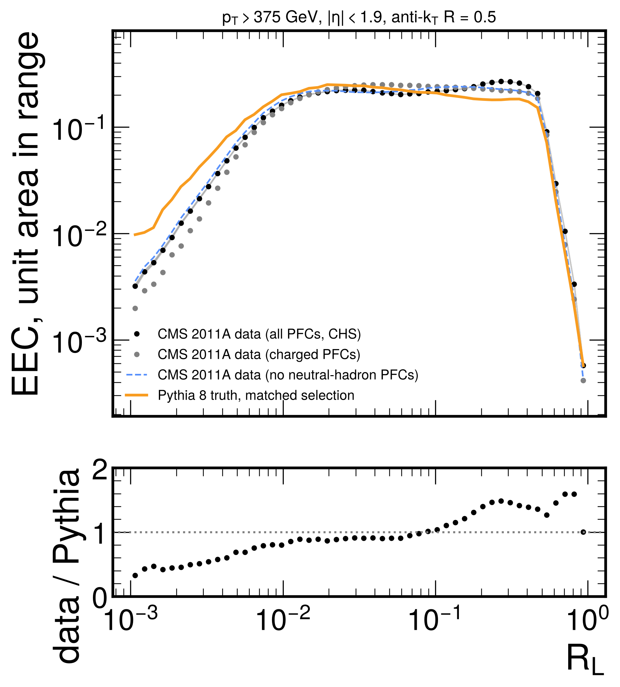

# First real-data EEC — CMS 2011A Open Data (MOD)

The first result in this repository that comes from collision data. The data are the CMS 2011A
Jet primary dataset in the MOD HDF5 format, compared with the matched Pythia 8 baseline of
[pythia_validation_results.md](pythia_validation_results.md) §4.

```bash
python src/validate_eec_pythia.py --preset mod2011 --n-events 40000 --seed 12345   # baseline table first
python src/analyze_mod.py --n-files 3
```

> **Detector-level data against generator-level MC.** There is no unfolding, no systematic
> uncertainty and no detector simulation. Errors are statistical only (jet-level SEM). The
> differences below are **observations**, not physics conclusions. A like-for-like comparison
> needs the MOD SIM sample (Pythia 6 + CMS detector simulation), which has not been run yet.

---

## Data and selection

| item | value |
|---|---|
| dataset | CMS 2011A Jet primary dataset, `CMS2011AJets` / `cms`, [10.5281/zenodo.3340205](https://doi.org/10.5281/zenodo.3340205), CC BY 4.0 |
| files used | **3 of 18**: `CMS_Jet300_pT375-infGeV_{0,1,2}_compressed.h5` (111.2, 111.6, 111.4 MB), md5-checked by `energyflow` 1.4.0 |
| stored in | `data/raw/mod/datasets/CMS2011AJets/CMS_Jet300_pT375-infGeV/` (not committed) |
| jets per file | 100000 before selection; one or two per event (file 0: 43649 events with one jet, 25459 with two) |
| selection | `corr_jet_pts > 375 & abs_jet_eta < 1.9 & quality >= 2` |
| jets after selection | **284059** (file 0 alone: 94567) |
| ⟨corrected pT⟩ | 447.9 GeV (Pythia baseline: 447.7 GeV) |
| jet weights | constant within the sample (2.61 × 10⁻⁶), so n_eff = number of jets |
| ⟨npv⟩ | 6.1 |
| PFCs | CHS (charged PFCs with vertex > 0 removed), rapidity converted to pseudorapidity |
| ⟨n_const⟩ | 38.6 all, 18.9 charged (Pythia truth: 42.1 all) |

**Runtime.** Downloading one file took 46 s. The analysis takes about 1 min per file on one core.

### Checks of the file contents against the code's assumptions

Before the first run, these were read off the files rather than assumed:

| assumption in `analyze_mod.py` | found in the file | status |
|---|---|---|
| PFC columns `(pt, y, phi, m, pid, vertex)` | `pfcs_cols = ['pt' 'y' 'phi' 'm' 'pid' 'vertex']` | ✅ |
| `corr_jet_pts`, `abs_jet_eta`, `quality`, `weights`, `npvs` exist | yes. `abs_jet_eta` is resolved by `energyflow` as \|`jet_etas`\| | ✅ |
| CHS: drop charged PFCs with vertex > 0 | `energyflow`'s own CHS keeps `vertex <= 0`. Neutrals are assigned to vertex 0, so the two rules give the same result | ✅ |
| PFCs are the jet's constituents | \|Σ p⃗T(PFC)\| / jet pT = 1.00000 (1st–99th percentile), max ΔR(PFC, jet axis) has median 0.49 | ✅ |
| pid values | {±11, ±13, 22, 130, ±211}. File 0, 375–450 GeV: charged hadrons (±211) 55% of the PFCs and 61% of the pT, photons (22) 37% / 31%, neutral hadrons (130) 7.7% / 7.2%, e and μ < 1% | ✅ |
| `quality` is 0–3 ("tight" = 3) | **every jet in file 0 has `quality = 5`** | ⚠️ the cut `quality >= 2` keeps everything. The value 5 is not explained in the `energyflow` docs. Not investigated further |

**Pipeline check: `normalisation = 1.000000`** ✅ (also on file 0 alone).

---

## EEC in jet-pT slices



| jet pT [GeV] | jets | global peak R_L | turnover R_L (R_L < 0.1) | half-rise R_L | half-rise R_L·⟨pT⟩ [GeV] data | same, Pythia | median rel. stat. error |
|---|---|---|---|---|---|---|---|
| 375–450 | 187442 | 0.269 | 0.034 | 0.0073 | 2.94 | 2.79 | 0.4% |
| 450–550 | 69626 | 0.309 | 0.030 | 0.0066 | 3.25 | 2.66 | 0.7% |
| 550–700 | 21918 | 0.269 | 0.026 | 0.0061 | 3.67 | 2.61 | 1.2% |
| 700–1000 | 4806 | 0.026 | 0.026 | 0.0058 | 4.57 | 2.54 | 2.7% |

Definitions (in `src/analyze_mod.py`):
- **global peak:** maximum over all R_L.
- **turnover:** maximum below R_L = 0.1.
- **half-rise:** the R_L where the small-angle side first reaches half the turnover value,
  log-interpolated between bins.

**Why three numbers.** In data the EEC is almost flat from R_L ≈ 0.02 to the jet edge, with a
second maximum near R_L ≈ 0.3 (next section). The global peak therefore lands at 0.27–0.31 in
three of the four slices and says nothing about hadronisation. The turnover is broad, so its bin
moves between neighbouring bins with the sample. With file 0 alone it is 0.034 / 0.026 / 0.022 /
0.030, against 0.034 / 0.030 / 0.026 / 0.026 with three files. **The half-rise is stable** (file
0 alone: 2.98 / 3.20 / 3.78 / 4.51 GeV). It is the number to use for the scaling check.

**Scaling with R_L·pT.**
- **Pythia:** the half-rise R_L·⟨pT⟩ is nearly constant across the four slices (2.79 → 2.54 GeV).
  This is the collapse seen in the baseline.
- **Data:** it grows from 2.94 to 4.57 GeV. In R_L it moves only from 0.0073 to 0.0058 (a factor
  1.26) while ⟨pT⟩ almost doubles. In the right panel the small-angle sides of the four slices
  are close but ordered by pT, not on one curve.
- **Charged PFCs only:** 3.56 → 4.81 GeV on file 0. Same trend, so it is not only photons and
  calorimeter granularity.

A fixed angular resolution or two-particle separation limit in reconstruction would produce
this pattern: a small-angle edge that stays at fixed R_L instead of moving as 1/pT. That is a
**hypothesis**. The SIM sample can test it by checking whether detector simulation of Pythia
truth reproduces the drift.

---

## Data vs Pythia 8 truth



All curves are normalised to unit area in the binned range ("shape"). Each EEC sums to 1
including the self-pairs at ΔR = 0, which lie outside the bins. Samples with different
multiplicity have different self-pair weight Σz², so raw curves would be offset (GUIDE §5
warning). Here the multiplicities differ: 38.6 constituents per jet in data (all PFCs), 18.9
charged-only, 42.1 in Pythia.

| region | data / Pythia shape (all PFCs, CHS) |
|---|---|
| R_L < 0.01 | **0.58** |
| 0.01 < R_L < 0.1 | 0.91 |
| 0.1 < R_L < 0.5 | **1.32** |
| turnover R_L | data 0.026, Pythia 0.019 |
| half-rise R_L (all slices together) | data 0.0069, Pythia 0.0061 |

Read the region ratios together. With unit-area shapes, less weight in one region forces more
weight elsewhere, so 0.58 at small angle and 1.32 at large angle are not independent.

**Small angle (R_L < 0.01).** Data have 0.58× the Pythia shape. Plausible sources at detector
level are angular resolution, merging of nearby particles into one PF candidate (for example the
two photons of a π⁰), and reconstruction thresholds. A tune difference is also possible: MOD SIM
uses Pythia 6, this baseline uses Pythia 8. Not separated here.

**Large angle (0.1 < R_L < 0.5).** Data have 1.32× the Pythia shape, with a second maximum at
R_L ≈ 0.3 that Pythia does not have. Which PFCs carry it:

| data shape relative to all PFCs | R_L < 0.01 | 0.01–0.1 | 0.1–0.5 |
|---|---|---|---|
| charged PFCs only | 0.74 | 1.10 | 0.93 |
| without neutral-hadron PFCs (pid 130) | 1.11 | 1.03 | 0.95 |

Shape means in finer R_L ranges, file 0, 375–450 GeV:

| PFC set | 0.1–0.2 | 0.2–0.45 |
|---|---|---|
| all (CHS) | 0.231 | 0.264 |
| no CHS | 0.241 | 0.278 |
| CHS, PFC pT > 1 GeV | 0.231 | 0.244 |
| CHS, npv ≤ 4 | 0.236 | 0.264 |
| CHS, npv ≥ 8 | 0.229 | 0.268 |
| without photons | 0.225 | 0.280 |
| **without neutral hadrons** | 0.242 | **0.227** |
| charged only | 0.238 | 0.222 |

- **Neutral-hadron PFCs carry the maximum at R_L ≈ 0.3.** They are 7% of the jet pT. Removing
  them removes the maximum (dashed curve in the figure). Removing photons does not.
- **Pileup does not.** The shape does not depend on npv and changes little with or without CHS.
- These are detector-level neutral hadrons (calorimeter energy not matched to tracks). Whether
  the maximum is a reconstruction effect or real wide-angle neutral energy cannot be decided
  without SIM. It is **not** claimed to be physics.

**Charged-only vs all PFCs.** Charged-only has less weight below R_L = 0.01 (0.74×) and more
between 0.01 and 0.1 (1.10×). Photons from π⁰ decays sit very close to each other and add
small-angle pairs. This is the expected direction, but again a statement about this sample, not
an extracted effect.

---

## Limitations

- **No unfolding, no detector simulation.** Every data/Pythia difference above mixes detector
  effects, Pythia 6 vs 8 tune differences and possible physics.
- **Statistical errors only,** jet-level SEM. Pairs within a jet are correlated, which the
  jet-level error takes into account. The two jets of the same event are treated as independent.
- **3 of 18 files** (284059 of about 1.79 M jets before cuts). Data statistics are already
  better than the Pythia baseline (effective 5840 jets). More files would not change the
  conclusions above, and Pythia statistics limit the ratio.
- **Jet quality cut is a no-op** on these files (`quality = 5` for all jets).
- **No trigger-efficiency or luminosity treatment.** The threshold 375 GeV is taken from
  arXiv:1908.08542 as the point where HLT_Jet300 is fully efficient. This was not re-checked.
- **Peak and turnover positions are quantised by the binning** (about 15% steps). Use the
  half-rise for scaling statements.

## Next

1. Run the MOD **SIM** sample through the same script. If SIM reproduces both the 0.58 / 1.32
   pattern and the R_L·pT drift, those are detector effects.
2. Compare MOD **GEN** with this Pythia 8 baseline to separate Pythia 6 vs 8 at truth level.
3. Then unfold, and compare with the published CMS Open Data EEC analysis (arXiv:2201.07800).
