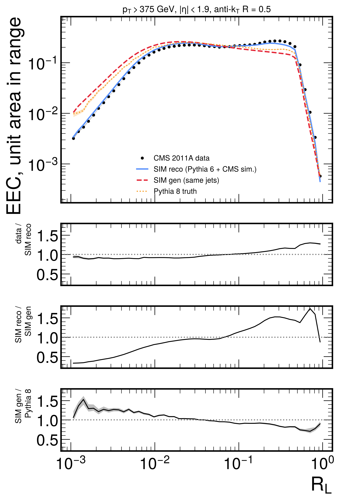
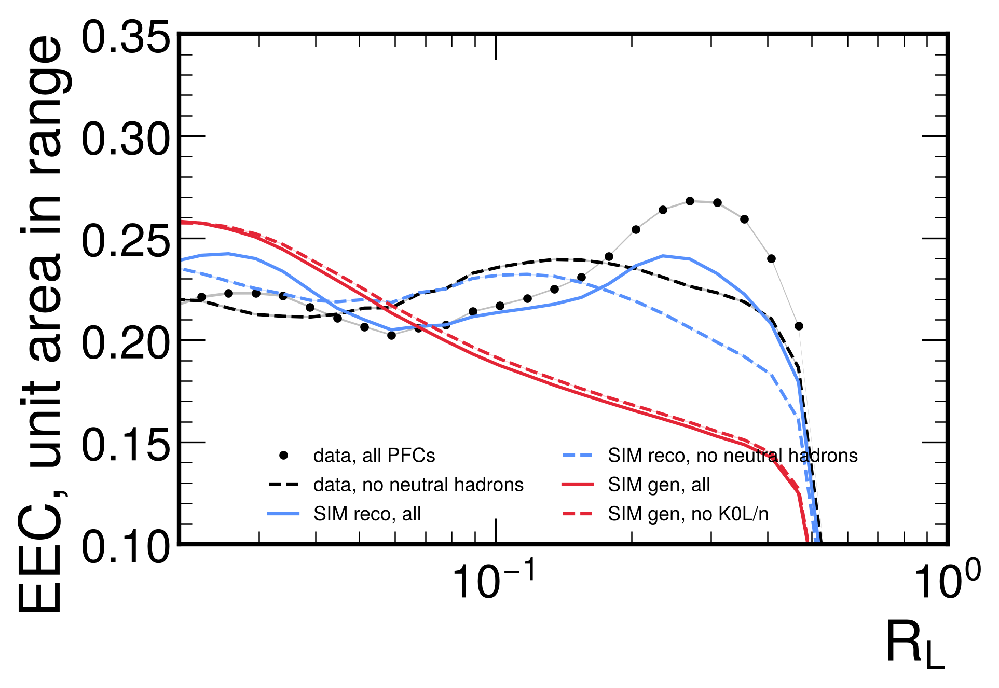
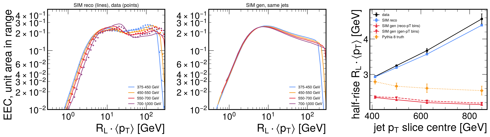

# Detector check of the CMS 2011A EEC with MOD SIM

[mod_data_results.md](mod_data_results.md) found three differences between CMS 2011A data and
Pythia 8 truth. This page checks them with the MOD **SIM** sample: Pythia 6 (tune Z2) events
passed through the CMS GEANT4 simulation and reconstructed like the data. Every SIM jet carries
both its detector-level PF candidates (`pfcs`) and the generator-level particles of the matched
GEN jet (`gens`). Reco and truth EEC can therefore be compared **on the same jets**.

```bash
python src/validate_eec_pythia.py --preset mod2011 --n-events 40000 --seed 12345   # Pythia 8 truth table
python src/analyze_mod.py --n-files 3                                              # data, 284059 jets
python src/analyze_mod_sim.py --files SIM170:1 SIM300:6 SIM470:6 SIM600:5 SIM800:3 \
    SIM1000:2 SIM1400:2 SIM1800:2 --data-files 3                                   # this page, bootstrap seed 2026
python src/analyze_mod_sim.py ... --kfactors --tag _kfactors                       # k-factor + npv reweighting variant
```

The two prerequisite runs were redone in a fresh container and reproduce the documented numbers
exactly: Pythia 8 has 14785 jets, n_eff 5840 and ⟨pT⟩ 447.7 GeV. Data has 284059 jets, data/Pythia
shape ratios of 0.58 / 0.91 / 1.32, and a half-rise R_L·⟨pT⟩ of 2.94 / 3.25 / 3.67 / 4.57 GeV.

> **Still no unfolding and no systematic uncertainties.** Errors are statistical only:
> a jet-level bootstrap (100 Poisson replicas, seed 2026) for data and SIM, and the jet-level
> SEM for Pythia 8. With 284k data jets and n_eff ≈ 7 × 10⁵ SIM jets, most statistical errors
> are below 1%. "Significant" below therefore means statistically significant. It does not mean
> outside detector or modelling systematics, which were not evaluated.

---

## Verdict

The table separates what is **confirmed** with SIM from what remains an observation or hypothesis.

| Observation (data vs Pythia 8 truth) | SIM result | Verdict |
|---|---|---|
| **1.** Small angle (R_L < 0.01): data/Pythia 8 = 0.58 | SIM-reco / SIM-gen = **0.520 ± 0.001** on the same jets. data / SIM-reco = 0.906 ± 0.005 | **Confirmed: mostly a detector effect.** A residual 9% deficit relative to SIM-reco remains. It is statistically significant and disappears for charged PFCs (0.99 ± 0.01) |
| **2.** Second maximum at R_L ≈ 0.3, carried by neutral-hadron PFCs (pid 130) | No maximum at generator level (SIM-gen rise 0.868, unchanged without K0L/n). SIM-reco has one (1.050), and removing reco neutral hadrons removes it (0.880) | **Confirmed: created in reconstruction by PF neutral hadrons.** Its size is under-predicted: data 1.141 vs SIM-reco 1.050 |
| **3.** Half-rise R_L·⟨pT⟩ grows with pT in data only (2.94 → 4.57 GeV) | SIM-reco 2.93 → 4.39 GeV. SIM-gen on the same jets 2.35 → 2.14 GeV | **Confirmed: a detector effect.** Truth-level scaling holds in Pythia 6 as in Pythia 8. Data and SIM-reco agree within 2–4% per slice |

**Factorisation check.** data/Pythia 8 = (data/SIM-reco) × (SIM-reco/SIM-gen) × (SIM-gen/Pythia 8):
- R_L < 0.01: 0.906 × 0.520 × 1.240 = 0.584 (measured 0.576)
- 0.1–0.5: 1.091 × 1.377 × 0.877 = 1.318 (measured 1.316)

The 0.58 is mainly the detector factor (0.52), partly offset by Pythia 6 having *more* small-angle
weight than Pythia 8 (1.24).

---

## Sample, weights and n_eff

| item | value |
|---|---|
| dataset | CMS 2011A MOD SIM (`CMS2011AJets` / `sim`), Pythia 6.4.25 tune Z2 + CMS GEANT4 simulation (arXiv:1908.08542 §II.4), read with `energyflow` 1.4.0, md5-checked |
| Zenodo records | SIM170 [3341500](https://doi.org/10.5281/zenodo.3341500), SIM300 [3341498](https://doi.org/10.5281/zenodo.3341498), SIM470 [3341419](https://doi.org/10.5281/zenodo.3341419), SIM600 [3364139](https://doi.org/10.5281/zenodo.3364139), SIM800 [3341413](https://doi.org/10.5281/zenodo.3341413), SIM1000 [3341502](https://doi.org/10.5281/zenodo.3341502), SIM1400 [3341770](https://doi.org/10.5281/zenodo.3341770), SIM1800 [3341772](https://doi.org/10.5281/zenodo.3341772) |
| files used | **27 of 355**, 6.0 GB, 44 min to download (one at a time, ~2.3 MB/s) |
| selection | same as data: `corr_jet_pts > 375 & abs_jet_eta < 1.9 & quality >= 2`. PFCs with CHS and rapidity → pseudorapidity (`pfcs_to_constituents` from `analyze_mod.py`). Gens use the same function (their vertex column is 0, so CHS does nothing) |
| gen columns | `(pt, y, phi, m, pid, vertex)`, the same as pfcs (checked in the file). Stable pids: e, μ, γ, π±, K±, p, K0L (130), n (2112). No neutrinos, K0S or Λ |
| matching | 99.9994% of selected jets have a GEN jet (`gen_jet_pt > 0` and non-empty gens). Only matched jets are used. SIM-reco with all jets vs matched only: max bin difference < 10⁻⁴ |
| processing | 14 min on 3 cores. Per-jet histograms are cached in `data/interim/` (not committed) |

| pT-hat slice | files (of total) | MB | jets after cuts | Σw [nb] | n_eff | share of Σw |
|---|---|---|---|---|---|---|
| SIM170 | 1 (1) | 31 | 13458 | 0.0546 | 13458 | 8.2% |
| SIM300 | 6 (24) | 1285 | 583681 | 0.454 | 583681 | 67.8% |
| SIM470 | 6 (73) | 1358 | 592334 | 0.126 | 592334 | 18.9% |
| SIM600 | 5 (78) | 1175 | 498696 | 0.0303 | 498696 | 4.5% |
| SIM800 | 3 (79) | 719 | 299860 | 3.67 × 10⁻³ | 299860 | 0.5% |
| SIM1000 | 2 (40) | 482 | 199915 | 6.6 × 10⁻⁴ | 199915 | 0.1% |
| SIM1400 | 2 (40) | 480 | 199920 | 2.2 × 10⁻⁵ | 199920 | < 0.1% |
| SIM1800 | 2 (20) | 475 | 199907 | 7.1 × 10⁻⁷ | 199907 | < 0.1% |
| **total** | **27** | **6005** | **2587771** | | **742139** | |

**Weights.** Within a slice every jet has the same cross-section weight, so a slice's n_eff
equals its jet count. When only some files of a slice are read, each weight is multiplied by
(slice total weight) / (summed weight of the files read, before cuts). This is the rule
`energyflow.mod.load` applies (`slice_weight_scale`, tested). Slices are then added with these
weights. The combined n_eff (742139) is much smaller than the jet count because the high slices
carry little weight. Per pT slice the n_eff is 398k / 277k / 222k / 159k, so the high-pT bins are
well populated. This is why more files of SIM600+ were read than their weight share suggests.

**⟨corr pT⟩** 447.3 GeV (data 447.9). **⟨n_const⟩** reco 38.4 (data 38.6), gen 41.6.
**Neutral-hadron pT fraction** reco 0.075 (data 0.073), gen (K0L + n) 0.100.

### k-factors and pileup reweighting

SIM pileup is higher than data: ⟨npv⟩ 7.68 vs 6.05. The `--kfactors` variant multiplies the SIM
weights by `energyflow.mod.kfactors('sim', corr_jet_pts, npvs)`. That factor is the NLO k-factor
in jet pT times the data/SIM npv-histogram ratio times the residual factor 0.961, as in
arXiv:1908.08542 §III.1. It brings ⟨npv⟩ to 6.00 and lowers n_eff to 601737 (the npv ratios
range from 0 to 1.66).

**Effect on every number on this page: ≤ 0.008 in the region ratios, ≤ 0.01 GeV in the
half-rise.** For example, data/SIM-reco is 0.905 / 0.949 / 1.094 with it and 0.906 / 0.950 /
1.091 without. The SIM-reco second-maximum ratio moves from 1.050 to 1.042. The nominal
results below are without k-factors, and the variant's full output is in
`results/tables/mod_sim_summary_kfactors.json`. This matches the data-only finding that the
shape does not depend on npv.

---

## Region ratios

Shapes are normalised to unit area over the binned range (`jeteec.eec.shape`). The self-pair
weight Σz² differs between samples with different multiplicity (reco 38.4, gen 41.6, data 38.6,
Pythia 8 42.1), so raw curves cannot be divided (GUIDE §5). Each cell is the mean over bins of the
bin-wise ratio, ± its bootstrap standard deviation.



| ratio of shapes | R_L < 0.01 | 0.01–0.1 | 0.1–0.5 |
|---|---|---|---|
| data / Pythia 8 (reproduced) | 0.576 ± 0.005 | 0.909 ± 0.003 | 1.316 ± 0.006 |
| **data / SIM-reco** | 0.906 ± 0.005 | 0.950 ± 0.001 | 1.091 ± 0.001 |
| **SIM-reco / SIM-gen** (same jets) | **0.520 ± 0.001** | 0.946 ± 0.000 | **1.377 ± 0.001** |
| **SIM-gen / Pythia 8** | 1.240 ± 0.014 | 1.015 ± 0.003 | 0.877 ± 0.004 |
| SIM-reco / Pythia 8 | 0.636 ± 0.006 | 0.957 ± 0.003 | 1.204 ± 0.005 |
| data / SIM-reco, charged PFCs | 0.992 ± 0.008 | 0.950 ± 0.001 | 1.087 ± 0.002 |
| SIM-reco / SIM-gen, charged | 0.518 ± 0.001 | 1.017 ± 0.000 | 1.142 ± 0.000 |
| data / SIM-reco, no neutral hadrons | 0.916 ± 0.005 | 0.961 ± 0.001 | 1.084 ± 0.001 |
| SIM-reco / SIM-gen, no neutral hadrons | 0.588 ± 0.001 | 0.960 ± 0.000 | 1.277 ± 0.000 |

Same-sample diagnostics (data numbers from mod_data_results.md, reproduced):

| shape relative to all particles | R_L < 0.01 | 0.01–0.1 | 0.1–0.5 |
|---|---|---|---|
| data: charged only | 0.745 | 1.102 | 0.934 |
| SIM-reco: charged only | 0.686 | 1.104 | 0.937 |
| data: no neutral hadrons | 1.108 | 1.032 | 0.946 |
| SIM-reco: no neutral hadrons | 1.097 | 1.020 | 0.951 |
| SIM-gen: no K0L / n | 0.970 | 1.005 | 1.016 |

### Observation 1: small angle

- **Confirmed detector effect.** Reconstruction removes about half of the small-angle weight on the
  same jets (0.520). The pattern holds for charged particles alone (0.518). It is therefore not
  only photon merging in the calorimeter. Tracks closer than the tracker's two-track resolution
  are also lost or merged. This last point is a *hypothesis* about the mechanism: SIM shows the
  size of the effect, not its cause.
- **Residual.** data / SIM-reco = 0.906 ± 0.005. That is 19σ statistically, but its size compares
  with plausible simulation-mismodelling systematics, which were not evaluated. For charged PFCs
  it vanishes (0.992 ± 0.008). The residual therefore sits in neutral, mainly photon, pairs at
  small angle: the real calorimeter merges or loses close neutral pairs more than the simulation.
  This is an **observation**. ECAL clustering, π⁰ modelling in Pythia 6 and the data/SIM photon
  energy scale cannot be separated here.
- **Generator part.** Pythia 6 Z2 has 1.24× Pythia 8's small-angle weight at truth level. The
  data/Pythia 8 ratio of 0.58 therefore *understates* the detector effect. On the same generator,
  reco/gen is 0.52, and the residual 0.91 multiplies it. The generator factor of 1.24 pushes the
  ratio back up to 0.58.

### Observation 2: second maximum at R_L ≈ 0.3



The table shows shape means in two large-angle ranges and their ratio. A ratio > 1 means the EEC
rises again towards a second maximum.

| sample | 0.1–0.2 | 0.2–0.45 | ratio |
|---|---|---|---|
| data, all PFCs | 0.2268 | 0.2589 | **1.141 ± 0.002** |
| data, no neutral hadrons | 0.2380 | 0.2240 | 0.941 ± 0.002 |
| SIM-reco, all | 0.2190 | 0.2300 | **1.050 ± 0.001** |
| SIM-reco, no neutral hadrons | 0.2295 | 0.2020 | 0.880 ± 0.001 |
| SIM-gen, all | 0.1781 | 0.1546 | 0.868 ± 0.001 |
| SIM-gen, no K0L / n | 0.1810 | 0.1570 | 0.867 ± 0.001 |
| Pythia 8 truth | 0.1956 | 0.1802 | 0.921 ± 0.010 |

- **Confirmed.** No generator-level sample has the maximum. Truth K0L and neutrons do not shape
  the large-angle EEC (removing them changes the ratio by 0.001). After simulation, the maximum
  appears, and removing the reconstructed neutral-hadron PFCs removes it. Generator-level neutral
  hadrons carry 10% of the jet pT, against 7.5% for reco neutral-hadron PFCs. The reco pid-130
  PFCs are therefore not a one-to-one image of truth K0L/n. They are HCAL energy not matched to
  tracks, and their angular pattern is set by reconstruction.
- **Size under-predicted.** The data maximum is larger than SIM-reco's (1.141 vs 1.050). The data
  excess at large angle (data/SIM-reco 1.09 in 0.1–0.5) is also present for charged PFCs (1.087)
  and without neutral hadrons (1.084). So it is not *only* neutral hadrons. This is an
  **observation**, not explained here. Candidates are the Pythia 6 large-angle radiation or
  underlying event, the data/SIM η mismatch noted in arXiv:1908.08542 §III.1, and HCAL response.
  npv reweighting does not change it.

### Observation 3: half-rise R_L·⟨pT⟩ vs pT



| jet pT [GeV] | data | SIM-reco | SIM-gen (same jets, reco-pT bins) | SIM-gen (gen-pT bins) | Pythia 8 truth | SIM n_eff (reco bins) |
|---|---|---|---|---|---|---|
| 375–450 | 2.94 ± 0.01 | 2.93 ± 0.01 | 2.35 ± 0.01 | 2.37 ± 0.01 | 2.79 ± 0.06 | 398484 |
| 450–550 | 3.25 ± 0.02 | 3.19 ± 0.01 | 2.28 ± 0.01 | 2.34 ± 0.01 | 2.66 ± 0.09 | 276879 |
| 550–700 | 3.67 ± 0.06 | 3.57 ± 0.01 | 2.20 ± 0.01 | 2.25 ± 0.01 | 2.61 ± 0.12 | 221816 |
| 700–1000 | 4.57 ± 0.14 | 4.39 ± 0.03 | 2.14 ± 0.01 | 2.18 ± 0.01 | 2.54 ± 0.13 | 158778 |

Values are in GeV. ⟨pT⟩ is the mean reco-corrected pT for data and SIM-reco, and the mean
gen-jet pT for SIM-gen.

- **Confirmed detector effect.** On the same jets, truth gives a nearly constant, slightly
  falling half-rise (2.35 → 2.14 GeV, the same trend as Pythia 8's 2.79 → 2.54). After simulation
  it grows 2.93 → 4.39 GeV, like the data. The small-angle edge of the reconstructed EEC stays near
  fixed R_L instead of moving as 1/pT. The *hypothesis* in mod_data_results.md, a fixed angular
  resolution or two-particle separation limit, is consistent with this. SIM shows the effect, not
  the mechanism.
- **Residual.** Data is above SIM-reco by 0.4% / 1.9% / 2.8% / 4.1%. In statistical terms that is
  0.7σ / 2.7σ / 1.6σ / 1.3σ, with the data error dominant. The size and sign are consistent with
  the residual small-angle deficit of observation 1.
- Binning by gen-jet pT instead of reco pT changes SIM-gen by ≤ 0.06 GeV, so jet-pT migration does
  not drive the result.

### Pythia 6 vs Pythia 8 at truth level

SIM-gen and the Pythia 8 baseline differ:
- small angle: 1.24×
- large angle: 0.88×
- half-rise R_L: 0.0053 vs 0.0061, i.e. R_L·pT ≈ 2.3 vs 2.7 GeV

Both scale with pT. This is a generator/tune difference (Pythia 6.4.25 Z2 vs Pythia 8.318
default), not a detector effect. It is not cleanly a tune statement yet, because the particle
definitions may differ. The MOD gens have K0S and Λ decayed (arXiv:1908.08542 §II.4), and the
stable-particle definition of the Pythia 8 baseline was not cross-checked against them.

---

## Jet quality (`quality`)

- **The "quality = 5" in mod_data_results.md was a reading error.** In `energyflow`, `ds.quality`
  is the *column index* of quality in `jets_i` (`['fn','rn','lbn','evn','npv','quality','hard_pid']`
  → 5). The per-jet values are `ds.qualitys`. The selection string `quality >= 2` uses the values
  and was always correct, so all jet counts stand.
- **Values.** The `energyflow` docstring gives 0 = none, 1 = loose, 2 = medium, 3 = tight. The
  paper (arXiv:1908.08542 §II.5, Table 3) defines the loose/medium/tight criteria from neutral-
  and charged-energy fractions and constituent counts, and imposes "medium". It does not spell out
  the 0–3 encoding, so the mapping rests on the energyflow docstring.
- **Counts:**

  | sample | 0 | 1 | 2 | 3 |
  |---|---|---|---|---|
  | data file 0, after pT and η cuts | 2419 | 628 | 72 | 94495 |
  | SIM300 file 0, all jets | 6 | 20 | 49 | 99925 |
  | after `quality >= 2`, data (3 files) | – | – | 217 | 283842 |
  | after `quality >= 2`, SIM (27 files) | – | – | 2083 | 2585688 |

  The medium cut removes **3.1% of data jets** but only 0.03% of SIM jets. The data-only part is
  consistent with the paper's remark (§III.3) that medium removes low-multiplicity jets that are
  "most likely" prompt photons. It may also include detector noise, which the simulation lacks.
  Not investigated further.

---

## Limitations

- **Statistical errors only.** No JES/JER, tracking-efficiency, PF-calibration or tune
  uncertainties. The ~1–9% data/SIM-reco residuals are statistically significant, but their
  meaning depends on systematics that were not evaluated.
- **27 of 355 SIM files.** All slices are represented, and the per-slice statistics exceed the data
  in every pT bin. The data error dominates every data/SIM comparison.
- **The bootstrap treats jets as independent.** The two jets of an event are correlated, which a
  per-event bootstrap would account for. The effect on the shape errors should be small, because
  the errors are far below the differences discussed, but it was not checked.
- **Pythia 8 vs SIM-gen are not like-for-like** in stable-particle definition (see above) or jet
  pT. SIM-gen uses reco-selected jets binned in reco pT (or gen pT), while Pythia 8 selects on the
  truth jet. The truth-level comparison is indicative.
- **No unfolding.** SIM shows that the three data features are mostly detector effects. Comparing
  with theory or with arXiv:2201.07800 needs an unfolding built from these same reco/gen pairs.
