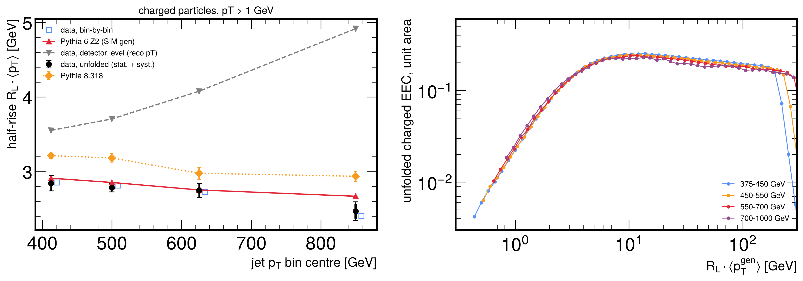
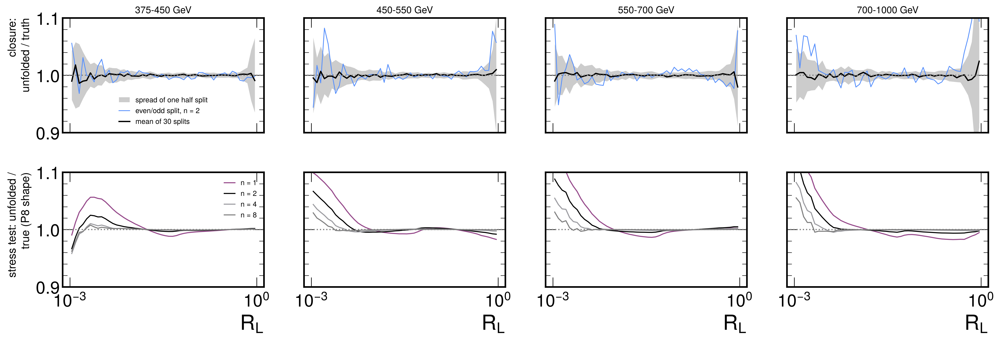
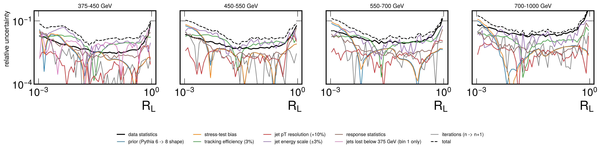
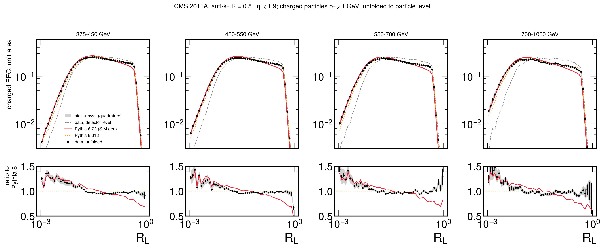

# Unfolding the CMS 2011A EEC to particle level (MOD SIM)

[mod_sim_results.md](mod_sim_results.md) showed that the three differences between CMS 2011A data
and Pythia 8 are mostly detector effects. This page removes them. The detector-level data EEC is
unfolded to **particle level** with a response built from the same MOD SIM jets (Pythia 6 Z2 +
CMS GEANT4 simulation). The result is compared with Pythia 6 and Pythia 8 truth.

The main observable is the **EEC of charged particles with pT > 1 GeV**, chosen for two reasons:
- The simulation reproduces the charged EEC better. At R_L < 0.01, data/SIM-reco is 0.992 for
  charged PFCs and 0.906 for all PFCs (mod_sim_results.md).
- The same data were analysed this way in arXiv:2201.07800 (charged PFCs, pT > 1 GeV).

All PFCs with pT > 1 GeV are unfolded the same way for comparison only.

```bash
# inputs as in mod_sim_results.md: data files 0-2 and SIM170:1 SIM300:6 SIM470:6 SIM600:5
# SIM800:3 SIM1000:2 SIM1400:2 SIM1800:2 (27 files, 6.0 GB; 22 min here with 3 parallel downloads)
for s in 12345 12346 12347 12348; do                       # Pythia 8 truth, charged pT > 1 GeV
  python src/validate_eec_pythia.py --preset mod2011 --n-events 50000 --seed $s \
      --charged-only --const-pt-min 1 --tag mod2011_ch1_s$s
done
python src/unfold_mod.py --files SIM170:1 SIM300:6 SIM470:6 SIM600:5 SIM800:3 SIM1000:2 \
    SIM1400:2 SIM1800:2 --data-files 3        # bootstrap seed 2026 (default), 100 data replicas
```

Processing all 30 files takes about 25 min on 2 cores, with results cached in
`data/interim/unfold/`. The analysis then runs in 15 s. Numbers: `results/tables/mod_unfolding_summary.json`.
Curves: `results/tables/eec_mod2011_unfolded.npz`.

**Reproduced in this container first.** The data run (`analyze_mod.py --n-files 3`) gives exactly
the documented numbers: 284059 jets, data/Pythia 8 shape ratios 0.58 / 0.91 / 1.32, and half-rise
2.94 / 3.25 / 3.67 / 4.57 GeV. The Pythia 8 baseline (seed 12345, 40000 events) also matches. The
SIM run reproduces the documented table (see [Reproduction](#reproduction)).

---

## Answer to the key question

**After unfolding, the small-angle edge of the charged EEC sits at a fixed R_L·pT. It no longer
sits at a fixed R_L.**



| jet pT [GeV] | ⟨pT^gen⟩ | data, detector level | **data, unfolded** | bin-by-bin | Pythia 6 Z2 (SIM gen) | Pythia 8.318 |
|---|---|---|---|---|---|---|
| 375–450 | 409.1 | 3.55 | **2.84 ± 0.02 ± 0.10** | 2.86 | 2.91 | 3.21 ± 0.04 |
| 450–550 | 488.7 | 3.71 | **2.79 ± 0.02 ± 0.05** | 2.81 | 2.85 | 3.18 ± 0.06 |
| 550–700 | 603.4 | 4.08 | **2.75 ± 0.04 ± 0.09** | 2.73 | 2.75 | 2.98 ± 0.08 |
| 700–1000 | 783.4 | 4.92 | **2.47 ± 0.10 ± 0.07** | 2.41 | 2.67 | 2.94 ± 0.07 |

Values are the half-rise R_L·⟨pT⟩ in GeV for charged particles with pT > 1 GeV. Unfolded values
are ± stat ± syst. The half-rise is the R_L at which the small-angle side reaches half the
turnover value. Detector-level values use the mean reco pT; the others use the mean gen-jet pT.

- **Ratio of the 700–1000 to the 375–450 GeV bin: 0.868 ± 0.036 (stat) ± 0.036 (syst).**
  Systematic shifts are applied to all pT bins together, so they are fully correlated.
  - A fixed angle (constant R_L) would give ⟨pT⟩ ratio = **1.92**. The detector-level data give 1.38.
  - Pythia 6 gives 0.917, Pythia 8 gives 0.914.
- **Confirmed (within the stated uncertainties):** the growth of the half-rise with pT in the
  detector-level data is removed by the unfolding. The particle-level transition scales as
  R_L ∝ 1/pT within about 13%.
- **Not constant at the 2.6σ level.** The unfolded half-rise falls by 13 ± 5% from 409 to 783 GeV.
  Both generators fall by about 8.5%, so data and generators agree within 1σ (0.868 vs 0.917:
  difference −0.05 ± 0.05).
  - Hypothesis, not tested: the fixed 1 GeV particle threshold breaks exact R_L·pT scaling.
  - Hypothesis, not tested: the quark/gluon jet mix changes with pT.
- Bin-by-bin correction and matrix unfolding agree within 0.06 GeV in every bin. The difference is
  inside the systematic uncertainty.

---

## Literature: what was checked and what was taken

Both papers were read from their arXiv TeX sources (`arxiv.org/e-print/...`), not from memory.

**Komiske, Moult, Thaler, Zhu, arXiv:2201.07800 (PRL 130 (2023) 051901), same CMS 2011A MOD data.**
- **No unfolding.** Footnote: "We use the term 'analysis' instead of 'measurement' to highlight
  that we have not corrected the data for detector effects". The text adds: "More detailed
  studies incorporating detector unfolding will be presented elsewhere". The supplement's
  all-hadron figure says "No unfolding to particle level is performed, and the uncertainty is
  statistical only".
- Selection: anti-kT R = 0.5, **pT ∈ [500, 550] GeV**, |η| < 1.9. Track-based observables
  ("those only using charged particles") from PFCs, with CHS and **PFC pT > 1 GeV "to minimize
  acceptance effects"**.
- **Consequence:** there is no corrected number in that paper to compare with. Its curves are
  detector level, like this repository's earlier pages. The charged-particle and 1 GeV choices
  above follow it. No direct numerical comparison is made here (see [Limitations](#limitations)).

**CMS, arXiv:2402.13864 (CMS-SMP-22-015), EEC unfolding at 13 TeV.**
- Iterative D'Agostini in RooUnfold: "We stop the iterations once the p-value between
  consecutive unfolded distributions exceeds 0.05".
- Matching: particles within ΔR < 0.05, jets within 0.2. If several match, the closest pT wins.
  Matched fractions: 80–84% of charged particles (88–95% of their energy), 54–70% of photons,
  20–35% of neutral hadrons.
- Fakes and misses: "The unmatched objects are considered to be misreconstructed and their
  contribution is subtracted from the data. After unfolding, bin-by-bin inefficiency corrections
  are applied".
- Unfolding in **three dimensions: x_L, pT and the energy weight**, with pT underflow and overflow
  bins (supplement).
- Particles: all charged and neutral particles with pT > 1 GeV.
- Systematics:

  | source | size |
  |---|---|
  | constituent energy scale | 1% charged, 3% photons, 5% neutral hadrons |
  | track reconstruction efficiency, "in the dense core of the jets" | 3% |
  | MC modelling, from re-unfolding with alternative generators (largest source) | 2–10% |

---

## Method

### Observable and binning
- **Per jet:** the EEC of the selected particles (charged, pT > 1 GeV).
  - Reco: charged PFCs after CHS. Gen: charged gen particles.
  - Weights 2 z_i z_j for pairs i < j, with z = pT / Σ pT over the selected particles of that
    level. This is the `norm="sum_pt"` convention of `jeteec/eec.py`.
  - R_L = ΔR in (η, φ), with rapidity converted to pseudorapidity as before.
- **R_L bins:** the same 50 log bins in 10⁻³–1 as all earlier pages.
- **Result:** a unit-area shape per jet-pT bin, `jeteec.eec.shape`. Absolute normalisation (per
  jet) would need the jet-pT spectrum to be unfolded as well, which was not done.
- **Jet pT bins:** reco uses the JEC-corrected pT, 4 bins plus overflow (≥ 1000 GeV). Gen uses the
  matched GEN-jet pT, with underflow (< 375 GeV), the same 4 bins, and overflow.
  - The response is 2D in (jet pT × R_L) on both sides, so **reco → gen jet-pT migration is part
    of the unfolding**. This matches CMS's pT dimension and its under/overflow bins.

### Pair-level response (the EEC is not a per-event observable)
A reco pair and a gen pair are not the same object, and a jet contributes about 160 pairs. The
response is therefore built from matched particles.

1. **Particle matching** (`jeteec.matching.match_particles`): same charge, ΔR < 0.05, closest pT
   (|ΔpT|/pT^gen). This is CMS's rule.
   - The match is one-to-one. A gen particle that loses its reco candidate to a closer-pT gen
     particle tries its next candidate, in repeated rounds.
   - The first version had no second choice and lost particles in dense cores. On SIM170 file 0,
     charged gen matching went from 0.849 to 0.870 and the fake pair weight from 0.195 to 0.131
     after the change.
2. **Matched pair:** a gen pair whose two particles are both matched. Its reco image is the pair
   of their partners.
3. Histograms:

   | histogram | contents | weight |
   |---|---|---|
   | `T_j` | all gen pairs, gen bin j | gen |
   | `M_ij` | matched pairs, (reco bin i, gen bin j) | **reco** |
   | `R_i` | all reco pairs | reco |

4. **Forward model:**

   ```
   reco_i = Σ_j A_ij t_j + fake_i,    A_ij = M_ij / T_j,    fake_i = R_i − Σ_j M_ij
   ```

   - The efficiency ε_j = Σ_i A_ij absorbs three things: unmatched gen pairs, pairs migrating out
     of range, and the mean reco/gen pair-weight ratio. The per-pair weight change is folded in
     this way instead of being unfolded as a third dimension as CMS does.
   - D'Agostini needs only this linear expectation. Its update is
     t_j ← (t_j/ε_j) Σ_i A_ij d_i / (A t)_i. Fakes are removed as a fraction, d_i ← d_i (1 − fake_i/R_i).
   - Tested by hand in `tests/test_unfold.py`: identity response, diagonal efficiency, prior =
     truth as a fixed point, the first iteration of a 2×2 example, and convergence from a flat
     prior.
5. **Sub-samples:** every SIM jet goes to one of 20 random sub-samples, with a fixed seed per file
   name. The histograms are filled per sub-sample, which allows closure splits and resampling of
   the response.
6. **Slice weights:** identical to mod_sim_results.md (`slice_weight_scale`); M, T and R are
   scaled per slice.

**Matching and fake fractions (charged, pT > 1 GeV)**

| | < 375 | 375–450 | 450–550 | 550–700 | 700–1000 | ≥ 1000 GeV |
|---|---|---|---|---|---|---|
| gen pair weight in matched pairs | 0.807 | 0.741 | 0.694 | 0.649 | 0.579 | 0.471 |
| the same, R_L < 0.01 | 0.727 | 0.621 | 0.551 | 0.494 | 0.416 | 0.314 |
| fake fraction of reco pair weight (reco bins) | – | 0.128 | 0.124 | 0.118 | 0.111 | 0.104 |

- **Particle counts.** 82.2% of charged gen particles and 87.5% of charged reco particles are
  matched. These are raw sums dominated by the high-pT slices. CMS quotes 80–84% for charged
  particles.
- **Small-angle correction is large at high pT.** At R_L < 0.01 more than half of the gen pair
  weight is not matched in the top bin. This is how the detector loses close track pairs, and
  the unfolding relies on the simulation getting it right (see systematics).
- **All PFCs.** Matched pair weight is 0.32–0.52 and fakes 13–20%. This is why it is only a
  comparison.

### Iterations
- **Rule (CMS):** stop at the first n where the p-value of χ² = Σ((t_n − t_{n−1})/σ_n)² exceeds
  0.05.
  - σ_n is the data bootstrap standard deviation of t_n, over the 4 reported pT bins × 50 R_L bins.
  - χ² between consecutive iterations: 107.9 (n = 2), 22.8, 8.4, 4.0 for 200 bins. **Charged: n = 2.**
  - All PFCs: n = 3 (χ²(n = 2) = 522.1, p ≈ 0).
- **Trade-off at R_L < 0.01, charged.** Mean over bins in the region, per pT bin:

  | n | stress-test bias (see below) | data stat. error |
  |---|---|---|
  | 1 | 3.6 / 4.2 / 5.3 / 5.9 % | 0.6 / 0.8 / 1.3 / 2.4 % |
  | **2** | **1.1 / 2.0 / 3.0 / 3.3 %** | **1.0 / 1.3 / 2.2 / 4.1 %** |
  | 4 | 0.1 / 1.0 / 1.5 / 1.7 % | 1.5 / 2.0 / 3.5 / 6.6 % |
  | 30 | 0.1 / 0.6 / 0.2 / 0.1 % | 4.5 / 6.0 / 10 / 20 % |

  (Diagnostic run with the unsmoothed Pythia 8 reweighting. The final bias at n = 2 with the
  smoothed reweighting is 0.9 / 2.1 / 2.9 / 3.2 %.)
- **Decision.** The rule was kept as fixed in advance, n = 2. The prior dependence that remains at
  n = 2 is carried as a systematic (stress-test bias and prior rows). A second row, n → n + 1, is
  also included.

---

## Validation



### Closure (SIM half → other SIM half)
- **Setup.** The response comes from 10 of the 20 sub-samples. The pseudo-data are the total reco
  histograms (fakes included) of the other 10, and their truth is the reference.
- **Why 30 random splits.** A single even/odd split is one statistical draw. Both halves fluctuate,
  and the iterations amplify the noise of the response half. For example, the even/odd split gives
  +1.8% in 700–1000 GeV at R_L < 0.01. The split is therefore repeated 30 times at random.
  - The mean over splits measures the method bias.
  - The spread measures the size of one draw.
  - The first version estimated the error by resampling only the pseudo-data half and got
    χ²/ndf 762/200. That error was too small.

| pT [GeV] | R_L < 0.01 | 0.01–0.1 | 0.1–0.5 | half-rise, unfolded − truth [GeV] |
|---|---|---|---|---|
| 375–450 | −0.13% ± 0.74% | +0.00% ± 0.10% | −0.01% ± 0.16% | −0.001 ± 0.028 |
| 450–550 | −0.17% ± 0.77% | +0.01% ± 0.12% | +0.06% ± 0.22% | +0.001 ± 0.022 |
| 550–700 | +0.05% ± 0.67% | −0.00% ± 0.18% | −0.02% ± 0.33% | +0.003 ± 0.039 |
| 700–1000 | −0.04% ± 0.97% | +0.07% ± 0.18% | −0.09% ± 0.39% | +0.021 ± 0.024 |

Each cell is the mean of (unfolded/truth − 1) over 30 splits ± the spread of one split. Charged
particles, n = 2.

- **Passed.** The mean bias is ≤ 0.2% in every region and pT bin.
  - Per-bin χ² of the mean, with σ = spread/√30: **235.6 / 200** (p ≈ 0.04, borderline).
  - All PFCs (n = 3): 148.0 / 200, mean bias ≤ 0.07%.
- **Caveat.** A per-bin χ² this close to the edge most likely reflects the crude spread estimate
  (30 overlapping splits of 20 groups), not a bias. It was not investigated further.
- **The identity property is exact:** pseudo-data = A t + fakes with prior t gives t back. This is
  a unit test.

### Model-dependence stress test (prior ≠ truth)
- **Fake data.** The SIM truth is reweighted, per gen pT bin and R_L bin, to the shape of the
  **Pythia 8 charged pT > 1 GeV truth** (mean of the 4 seeds). The reweighted truth is folded with
  the nominal response to make pseudo-data, which are then unfolded with the nominal Pythia 6
  prior.
- **Smoothing.** The reweighting function is a degree-4 polynomial fit in log R_L to log(P8/P6),
  weighted by the Pythia 8 errors.
  - The unsmoothed ratio carries Pythia 8's statistical noise, about 7k effective jets per bin.
    The unfolding smooths that noise, which made the test oscillate by ±10% at R_L < 0.005.
  - A model change is smooth (`smooth_ratio`, tested for no bias).
  - This is a reweighting of the truth only. The response stays Pythia 6 + GEANT4.

| pT [GeV] | R_L < 0.01 | 0.01–0.1 | 0.1–0.5 | half-rise, unfolded vs true [GeV] |
|---|---|---|---|---|
| 375–450 | +0.9% | −0.1% | −0.1% | 3.286 vs 3.310 |
| 450–550 | +2.1% | −0.1% | −0.0% | 3.152 vs 3.146 |
| 550–700 | +2.9% | −0.3% | +0.1% | 2.999 vs 3.023 |
| 700–1000 | +3.2% | −0.2% | −0.5% | 2.868 vs 2.895 |

Values are the mean of (unfolded/true − 1), n = 2.

- **Result.** The unfolding is pulled toward the Pythia 6 prior where the response is weakest, at
  R_L < 0.01 with matched weight 42–62%. The pull is +1 to +3% there and below 0.5% elsewhere.
  - In the lowest bins (R_L ≈ 1–2 × 10⁻³) it reaches 5–10%.
  - On the half-rise it is ≤ 0.03 GeV.
- **Kept as a systematic:** the bias times the shape, signed.

---

## Systematic uncertainties



For each source, the data are re-unfolded with the varied input. Its uncertainty is the difference
from the nominal shape, with the sign kept for the half-rise. Sources are added in quadrature with
the data statistical error. Region values below are means over bins of |Δ|/shape, in %, for the
pT bins 375–450 / 450–550 / 550–700 / 700–1000.

| source | method | R_L < 0.01 | 0.01–0.1 | 0.1–0.5 |
|---|---|---|---|---|
| data statistics | 100 Poisson jet-level replicas (seed 2026), each unfolded | 1.1 / 1.3 / 2.1 / 4.0 | 0.4 / 0.5 / 1.0 / 2.1 | 0.4 / 0.6 / 1.2 / 2.7 |
| model: prior | prior = Pythia 6 truth reweighted to the Pythia 8 shape | 1.3 / 2.1 / 2.5 / 2.6 | 0.2 / 0.2 / 0.4 / 0.3 | 0.1 / 0.2 / 0.1 / 0.6 |
| model: stress-test bias | bias of the stress test above | 1.4 / 2.3 / 2.9 / 3.2 | 0.2 / 0.2 / 0.3 / 0.2 | 0.1 / 0.2 / 0.1 / 0.5 |
| tracking efficiency | 3% of reco tracks removed at random (per-file seed), response rebuilt. 3% as in CMS arXiv:2402.13864 ("mismodeling ... in the dense core of the jets") | 1.9 / 2.0 / 1.8 / 2.0 | 0.6 / 0.6 / 0.6 / 0.7 | 0.9 / 1.0 / 1.0 / 1.2 |
| jet energy scale | data jet pT × (1 ± 3%), larger shift kept (see below) | 3.0 / 3.2 / 2.5 / 2.1 | 0.6 / 0.8 / 0.7 / 1.6 | 0.9 / 0.8 / 1.1 / 1.4 |
| jet pT resolution | SIM reco pT = gen + 1.10 × (reco − gen), response rebuilt | 0.2 / 0.3 / 0.3 / 0.6 | 0.1 / 0.2 / 0.2 / 0.2 | 0.1 / 0.1 / 0.2 / 0.2 |
| response statistics | 50 resamples of the 20 SIM sub-samples | 1.3 / 1.2 / 1.1 / 1.2 | 0.3 / 0.3 / 0.3 / 0.4 | 0.2 / 0.3 / 0.3 / 0.4 |
| jets lost below 375 GeV | see below, first bin only | 0.8 / – / – / – | 0.6 / – / – / – | 0.5 / – / – / – |
| iterations | n = 2 → 3 | 0.9 / 0.9 / 1.1 / 2.0 | 0.1 / 0.1 / 0.3 / 0.6 | 0.0 / 0.1 / 0.2 / 0.3 |

**Half-rise R_L·⟨pT⟩ [GeV], shift per source (375–450 / 450–550 / 550–700 / 700–1000):**

| source | shift | effect on the 700–1000 / 375–450 ratio |
|---|---|---|
| data statistics | ±0.015 / 0.023 / 0.042 / 0.101 | ±0.036 |
| prior | +0.020 / −0.001 / +0.022 / +0.026 | +0.003 |
| stress-test bias | −0.020 / +0.002 / −0.024 / −0.034 | −0.006 |
| tracking efficiency | −0.043 / −0.032 / −0.040 / −0.037 | 0.000 |
| jet energy scale | −0.077 / −0.042 / +0.066 / +0.012 | +0.028 |
| jet pT resolution | +0.002 / +0.009 / +0.010 / +0.013 | +0.004 |
| response statistics | ±0.016 / 0.010 / 0.017 / 0.019 | ±0.010 |
| jets lost below 375 GeV | +0.043 / – / – / – | −0.013 |
| iterations | +0.003 / +0.003 / +0.008 / −0.037 | −0.014 |
| **total syst** | **0.103 / 0.054 / 0.087 / 0.073** | **0.036** |

**Notes on the sources**
- **Tracking efficiency.** Removing tracks moves every pT bin the same way (−0.03 to −0.04 GeV),
  so it cancels in the ratio. A *random* 3% loss does not model a mismodelled **two-track
  separation** in dense cores, which is the mechanism that removes small-angle pairs.
  - The detector-level charged data/SIM-reco at R_L < 0.01 is 0.996 / 0.978 / 0.982 / 0.997 in the
    four reco pT bins (0.951 / 0.949 / 0.950 / 0.937 at 0.01–0.1; 1.09–1.15 at 0.1–0.5).
  - This bounds the combined effect of such mismodelling and real physics differences to about 2%
    at small angle. It cannot separate the two. Not evaluated as a separate systematic.
- **Jet energy scale.** The MOD files carry the JEC factor (`jec`) but **no JEC uncertainty**.
  - ±3% is a conservative round number. The CMS JEC paper for 2010 data (arXiv:1107.4277) states a
    total uncertainty below 3% for pT > 50 GeV, |η| < 3.0. A 2011-specific table for high-pT
    central jets was not found and is not claimed.
  - The data already have corr pT > 375 GeV, so an upward shift cannot bring jets in from below.
    The shift is asymmetric in the first bin.
  - The shifts change sign between pT bins (−0.077 … +0.066 GeV). Part of this is the statistical
    fluctuation of the data jets that migrate, which is not separated here.
- **Jet pT resolution.** 10% wider than the simulation is an **assumption**. It was meant as a
  typical size for 2011 data/MC resolution factors, but those factors could not be verified here.
  The effect is small (≤ 0.6%) because the response already contains the pT migration.
- **Jets lost below 375 GeV.** The MOD SIM files contain only jets with reco corr pT > 375 GeV.
  Gen 375–450 jets reconstructed below 375 GeV are missing from both response and truth, so the
  unfolded first bin describes "gen 375–450 jets that pass the reco cut".
  - Proxy: gen 450–550 jets reconstructed one bin lower carry 18.7% of that bin's pair weight.
    Their shape differs from jets reconstructed in their own bin by −3.7% / +2.0% / −1.2% in the
    three regions.
  - Systematic = share × difference, applied to the first bin only (+0.043 GeV on its half-rise).
- **Model dependence of the response itself is not evaluated.** Only Pythia 6 has detector
  simulation in MOD. A different hadronisation model could change the response itself, for
  example the track density that drives merging, and only a second simulated generator can test
  that. CMS calls this its largest source (2–10%). The two "model" rows above cover only the
  prior.

---

## Results



**Unfolded charged EEC / generator truth.** Mean over bins in each region ± mean total uncertainty
(stat ⊕ syst).

| pT [GeV] | / Pythia 6 Z2: R_L < 0.01 | 0.01–0.1 | 0.1–0.5 | / Pythia 8.318: R_L < 0.01 | 0.01–0.1 | 0.1–0.5 |
|---|---|---|---|---|---|---|
| 375–450 | 0.99 ± 0.05 | 0.955 ± 0.012 | 1.096 ± 0.016 | 1.21 ± 0.06 | 0.989 ± 0.013 | 0.971 ± 0.014 |
| 450–550 | 0.97 ± 0.06 | 0.956 ± 0.012 | 1.112 ± 0.017 | 1.17 ± 0.07 | 0.983 ± 0.013 | 0.978 ± 0.015 |
| 550–700 | 0.98 ± 0.06 | 0.960 ± 0.015 | 1.128 ± 0.023 | 1.18 ± 0.08 | 0.973 ± 0.015 | 0.979 ± 0.020 |
| 700–1000 | 1.00 ± 0.08 | 0.949 ± 0.028 | 1.164 ± 0.040 | 1.20 ± 0.10 | 0.960 ± 0.029 | 0.965 ± 0.033 |

- **Small angle (confirmed within uncertainties).** At particle level the data agree with
  Pythia 6 Z2. They have 17–21% more small-angle weight than Pythia 8.318 (2.0–3.5 σ per pT bin
  with the total uncertainty).
  - At detector level the comparison with Pythia 8 was 0.58. That was the detector, not physics.
- **Large angle (observation).** The data excess over Pythia 6 at R_L = 0.1–0.5 remains after
  unfolding (1.10–1.16, growing with pT). Its size equals the detector-level data/SIM-reco
  (1.09–1.15). Pythia 8 describes this region (0.97–0.98).
  - The unfolding uses a Pythia 6 response. The excess is therefore a statement about Pythia 6
    Z2's large-angle radiation or underlying event, unless the response itself is mismodelled
    there. That cannot be separated here (no second simulated generator).
- **The second maximum at R_L ≈ 0.3 is absent in the charged EEC.** This is expected: it came
  from PF neutral hadrons (mod_sim_results.md).

**All PFCs, pT > 1 GeV (comparison only).** Systematics evaluated: JES, response statistics, jet
loss and iterations. Not evaluated: prior, tracking, and **neutral energy scale**.

| quantity | 375–450 | 450–550 | 550–700 | 700–1000 |
|---|---|---|---|---|
| half-rise R_L·⟨pT⟩, unfolded [GeV] | 2.41 ± 0.01 ± 0.09 | 2.40 ± 0.02 ± 0.07 | 2.28 ± 0.02 ± 0.05 | 2.19 ± 0.04 ± 0.04 |
| detector level | 2.95 | 3.25 | 3.68 | 4.57 |
| Pythia 6 truth | 2.37 | 2.35 | 2.25 | 2.19 |
| unfolded / Pythia 6, R_L < 0.01 | 0.92 | 0.91 | 0.92 | 0.92 |
| unfolded / Pythia 6, 0.1–0.5 | 1.12 | 1.14 | 1.16 | 1.23 |

- Half-rise ratio 700–1000 / 375–450: 0.911 ± 0.015 ± 0.025, against 0.923 in Pythia 6.
- The same conclusion, R_L·pT scaling, holds for all particles.
- With the full particle content, about 8% less small-angle weight than Pythia 6 remains. This
  is the neutral residual of mod_sim_results.md (detector level 0.90–0.91, now unfolded). It is
  not corrected away because the response is the same Pythia 6 simulation. The all-PFC
  unfolding relies on neutral-particle simulation, which matches only 20–50% of the pair weight.
  That is why it is not the main result.

**Comparison with the literature.** No numerical comparison was made.
- arXiv:2201.07800 is not unfolded and uses 500–550 GeV.
- Its normalisation would have to be matched first (`jeteec/eec.py` header). Their Eq. (2)
  divides by the jet energy, while this page uses Σ pT of the selected particles and unit-area
  shapes.
- A detector-level comparison in 500–550 GeV is possible as a next step.

---

## Reproduction

| check | value |
|---|---|
| tests | `python -m pytest -q tests`: 88 passed (70 before this page) |
| data, `analyze_mod.py --n-files 3` | 284059 jets, 0.58 / 0.91 / 1.32, half-rise 2.94 / 3.25 / 3.67 / 4.57 GeV: identical to mod_data_results.md |
| Pythia 8, `--preset mod2011 --n-events 40000 --seed 12345` | PASS (as before) |
| Pythia 8 charged pT > 1 GeV, 4 × 50000 events, seeds 12345–12348 | PASS each. ⟨n⟩ 17.9–18.2 charged particles per jet. n_eff per pT bin 15454 / 12335 / 9314 / 6223 (sum of 4) |
| SIM, `analyze_mod_sim.py` (27 files, bootstrap seed 2026) | see the note below |
| this page, `unfold_mod.py` (seed 2026, 100 data replicas, 50 response resamples, 30 splits) | numbers above |

<!-- SIM_REPRO -->

A single 200k-event Pythia 8 run was killed for lack of memory (15 GB, shared with the SIM
processing). Four equal-size runs are averaged instead, with error √(Σσ²)/4.

---

## Limitations

Each limitation below is either something not evaluated or a hypothesis.
- **Response model dependence not evaluated.** There is only one simulated generator (Pythia 6 Z2).
  The prior variation and stress test do not cover a different response.
- **Two-track separation mismodelling** in dense cores is bounded only indirectly, by detector-level
  data/SIM-reco ≈ 0.98–1.00 at R_L < 0.01. This is where the correction is largest (factor 2–3
  in the top pT bin).
- **The JES (±3%) and JER (+10%) sizes are not 2011-specific CMS values.** The MOD files have no JEC
  uncertainty. Pileup (⟨npv⟩ 6.0 data vs 7.7 SIM) is not varied. mod_sim_results.md found
  npv reweighting changes detector-level ratios by ≤ 0.008.
- **The first pT bin** is defined by the reco cut (jets lost below 375 GeV). The correction is a
  proxy from the next bin.
- **Shape only.** Neither the jet-pT spectrum nor the per-jet normalisation is unfolded.
- **The energy weight is folded into the response** (efficiency = mean reco/gen weight ratio per
  gen bin). It is not unfolded as a separate dimension as in CMS arXiv:2402.13864.
- **The statistical model treats jets as independent.** The two jets of an event are correlated,
  as in mod_sim_results.md.
- **Iteration choice.** n = 2 by the CMS rule. The residual prior dependence is a systematic, but
  the stopping rule was not tuned or re-derived for this binning.
- **⟨pT^gen⟩ per bin** comes from the SIM (reco-selected jets), not from data.
- **The all-PFC unfolding** lacks the prior, tracking and neutral-energy-scale systematics.
