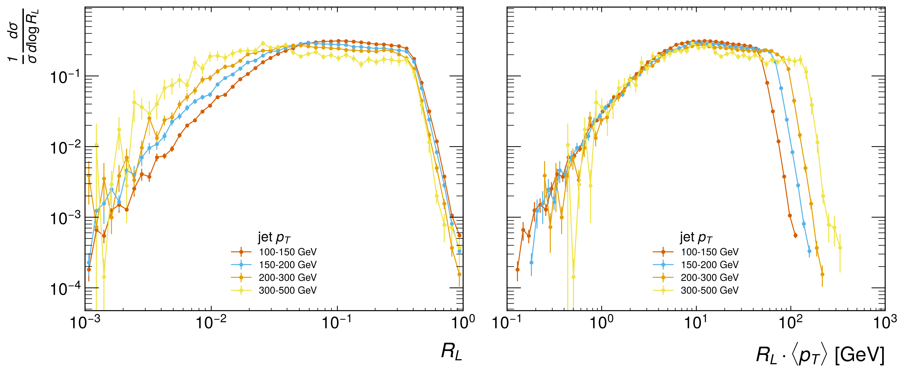
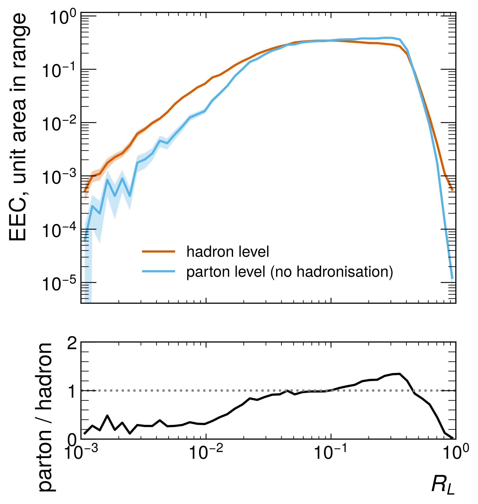
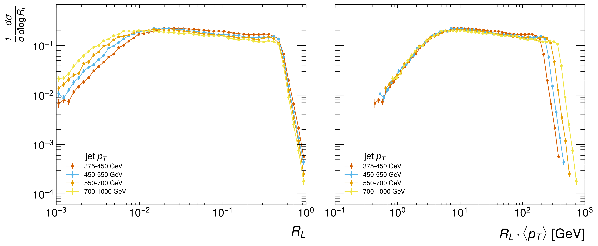
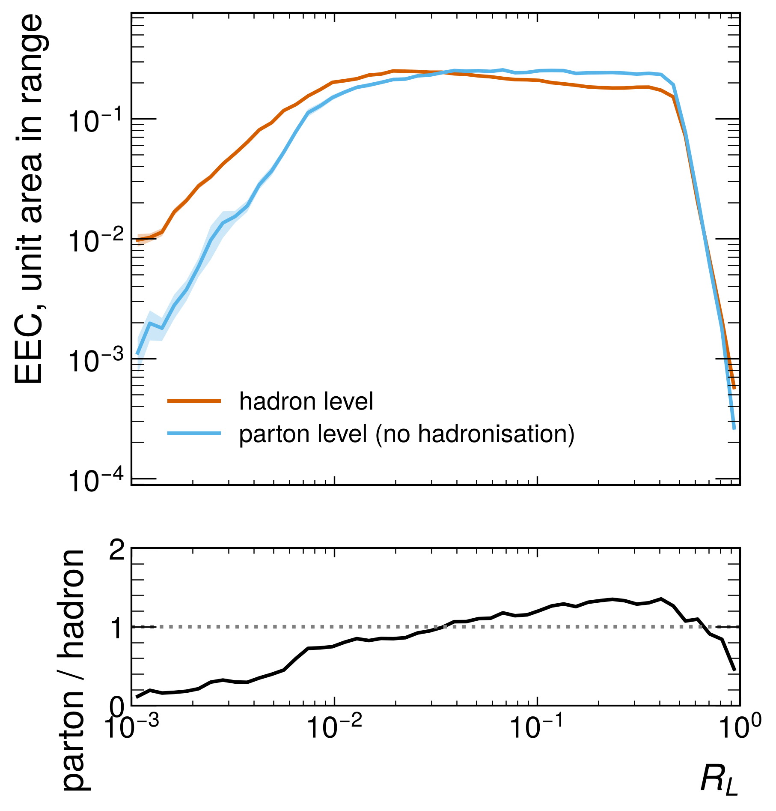

# Pythia validation — results

Step 1 of the README Quick start, run on Pythia 8 generator truth. This is the first result in
the repository that comes from a real parton shower and hadronisation model, not the toy
generator.

```bash
python src/validate_eec_pythia.py --n-events 10000 --seed 12345 --compare-hadronisation
```

Pythia 8.318 (PyPI `pythia8mc`), `HardQCD:all = on`, pp at 13 TeV, `PhaseSpace:pTHatMin = 100`
GeV. Final-state visible particles with |η| < 4 and pT > 0.2 GeV. Anti-kT R = 0.4, jet pT > 100
GeV, |η| < 2. Runtime about 2 minutes on one CPU core.

> **Generator truth, not data.** There is no detector, no pileup and no unfolding. These numbers
> show that the pipeline produces the expected physics on a known input. They are not a
> measurement.

---

## 1. Pipeline check

| quantity | result |
|---|---|
| events | 10000 |
| jets | 9129 |
| ⟨pT⟩ | 139.5 GeV |
| ⟨n_const⟩ | 26.5 |
| EEC normalisation | **1.000000** ✅ |

**Verdict: PASS.** Step 1 of the Quick start has now actually been passed.

---

## 2. EEC in jet-pT slices



| jet pT [GeV] | jets | EEC peak R_L | peak R_L·⟨pT⟩ [GeV] | median rel. stat. error |
|---|---|---|---|---|
| 100–150 | 6788 | 0.102 | 12.3 | 2.8% |
| 150–200 | 1610 | 0.059 | 10.0 | 5.2% |
| 200–300 | 631 | 0.051 | 11.9 | 7.4% |
| 300–500 | 91 | 0.026 | 9.2 | 15.4% |

Errors are the standard error of the mean over jets (see `jeteec/eec.py`).

**The small-angle side scales with 1/pT.** In R_L (left panel) the curves separate: higher-pT
jets reach further into small angles. In R_L·⟨pT⟩ (right panel), the rising small-angle side of
all four slices falls on one curve up to about 3 GeV. The peak moves by a factor of 4 in R_L but
stays at 9–12 GeV in R_L·pT. So the transition is set by a fixed momentum scale and not by an
angle, which is what a hadronisation (confinement) transition should look like. The large-angle
edge, by contrast, is fixed at R_L ≈ R = 0.4 in the left panel and spreads out in the right one,
because it comes from the jet radius rather than from QCD dynamics.

**Caveats.**
- The peak position is read off from 50 log bins over three decades, so it is quantised in steps
  of about 15%.
- The 300–500 GeV slice has 91 jets. Use more events or a higher `pTHatMin` before quoting it.
- The absolute R_L·pT value of the peak depends on how "peak" is defined and binned. Only its
  constancy across slices is a robust statement here; don't compare 9–12 GeV directly with a
  number in the literature.

---

## 3. Hadronisation on vs off



Same seed, same cuts, `HadronLevel:all = off`. Jets are clustered from the post-shower partons.

| | hadron level | parton level |
|---|---|---|
| jets | 9129 | 9306 |
| ⟨n_const⟩ | 26.5 | 7.9 |
| EEC peak R_L | 0.102 | 0.269 |
| binned EEC area | 0.876 | 0.621 |

| shape ratio parton/hadron (unit area in range) | |
|---|---|
| 0.1 < R_L < 0.4 (perturbative) | 1.19 |
| R_L < 0.01 (hadronisation) | **0.28** |

**The small-angle part of the EEC comes from hadronisation.** At large angles the parton-level
and hadron-level shapes agree to about 20%. Below R_L = 0.01 the parton level carries only about
a quarter of the hadron-level weight. Hadronisation moves energy flow into small angles.

**A pitfall found while doing this.** The first comparison showed the parton level about 30%
*below* hadron level everywhere, including the perturbative region. That is not physics. Every
EEC sums to 1 *including* the self-pairs at ΔR = 0, which fall outside the bins. A parton-level
jet has about 8 hard constituents, so its self-pair weight Σzᵢ² is much larger and less weight is
left for the visible bins (binned area 0.62 vs 0.88). The comparison must use shapes normalised
to a common range. **The same trap applies to any EEC comparison between samples with different
constituent multiplicity**: charged-only vs all particles, different pT thresholds, or data vs MC
at different tiers.

---

## 4. Baseline matched to the CMS 2011A MOD dataset

The reference that real data from the `CMS2011AJets` MOD dataset
([10.5281/zenodo.3340205](https://doi.org/10.5281/zenodo.3340205)) will be compared against.
The jet selection is matched to the dataset: pp at **7 TeV**, the **two hardest anti-kT R = 0.5**
jets per event, then **pT > 375 GeV** and **|η| < 1.9**.

```bash
python src/validate_eec_pythia.py --preset mod2011 --n-events 40000 --seed 12345 --compare-hadronisation
```

Runtime 5 min 41 s on one core (both hadron and parton level).

**Generator cut: why pTHatMin = 150 with a bias.** With R = 0.5 a jet often comes out harder than
the hard scatter (ISR, UE, wide-angle radiation). In a direct check, **8.5% of jets above 375 GeV
came from pTHat < 300 GeV and 3.3% from pTHat < 250 GeV.** Those are exactly the jets with extra
radiation, so a cut near the threshold would bias the EEC. The preset therefore generates from
pTHat = 150 GeV with `PhaseSpace:bias2Selection` (power 4, reference 150 GeV) and uses the event
weights. With this setting **none of 1440 selected jets came from pTHat < 200 GeV.** The cost is
weight spread: 14785 jets give an effective sample of 5840 (`n_eff = (Σw)²/Σw²`).

### Pipeline check

| quantity | result |
|---|---|
| events | 40000 (pT-hat biased, weighted) |
| jets | 14785 (effective 5840) |
| ⟨pT⟩ (weighted) | 447.7 GeV |
| ⟨n_const⟩ (weighted) | 42.1 |
| EEC normalisation | **1.000000** ✅ |

### EEC in jet-pT slices



| jet pT [GeV] | jets | effective | EEC peak R_L | peak R_L·⟨pT⟩ [GeV] | median rel. stat. error |
|---|---|---|---|---|---|
| 375–450 | 5193 | 3010 | 0.019 | 7.9 | 2.7% |
| 450–550 | 4191 | 2526 | 0.015 | 7.2 | 3.0% |
| 550–700 | 3002 | 1757 | 0.015 | 8.9 | 3.4% |
| 700–1000 | 1902 | 1340 | 0.010 | 7.6 | 4.4% |

At these pT the three regions are clearly separated:
- **Small angle:** a rising free-hadron side.
- **Turnover:** near R_L·pT ≈ 7–9 GeV.
- **Scaling region:** a slowly falling stretch between the turnover and the jet edge at R = 0.5.

Against R_L·⟨pT⟩ (right panel) **the whole small-angle side of all four slices collapses onto one
curve**, from 0.5 GeV up to the peak, much more cleanly than the lower-pT R = 0.4 sample in §2.
The jet edge spreads out by slice, as it must. The scaling region is now long enough (over a
decade in R_L) for its slope to be fitted, which is what an αs-sensitive measurement uses.

Same caveats as §2. The peak is quantised by the binning (about 15% steps). Only its constancy
across slices is a robust statement, not its absolute value.

### Hadronisation on vs off



| | hadron level | parton level |
|---|---|---|
| jets | 14785 | 15164 |
| ⟨n_const⟩ | 42.1 | 12.3 |
| EEC peak R_L | 0.019 | 0.068 |
| binned EEC area | 0.880 | 0.648 |
| shape ratio parton/hadron, 0.1 < R_L < 0.5 | | 1.30 |
| shape ratio parton/hadron, R_L < 0.01 | | **0.37** |

As at R = 0.4, the small-angle weight comes from hadronisation (parton level 0.37× below
R_L = 0.01).

**Read the large-angle ratio of 1.30 with care.** Both curves are normalised to unit area in the
binned range. Because hadronisation pushes weight into small angles, normalising to equal total
area lifts the parton curve at large angles automatically. A ratio above 1 there is therefore
partly a consequence of the normalisation and not a statement that the perturbative region
differs by 30%. A cleaner comparison would normalise both curves in the scaling region alone.
Do that before quoting a non-perturbative correction factor.

### Use with the MOD data

- This is **generator-level truth**. The MOD data are detector-level PF candidates. Compare data
  with the MOD **SIM** sample (Pythia 6 + CMS simulation). Use this Pythia 8 sample and MOD
  **GEN** for the particle-level comparison after unfolding.
- Apply the same selection to the data: two hardest jets, then pT > 375 GeV, |η| < 1.9. The
  paper's jet-quality cut (arXiv:1908.08542) has no generator-level equivalent.
- Pythia 8 here versus Pythia 6 in MOD SIM/GEN: tune differences are expected in exactly the
  small-angle region.
