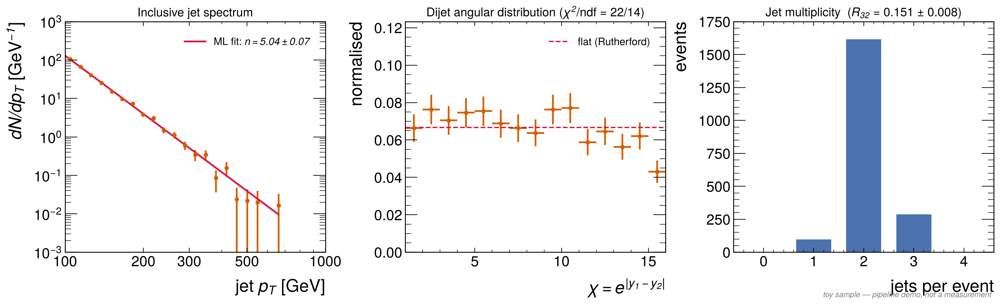
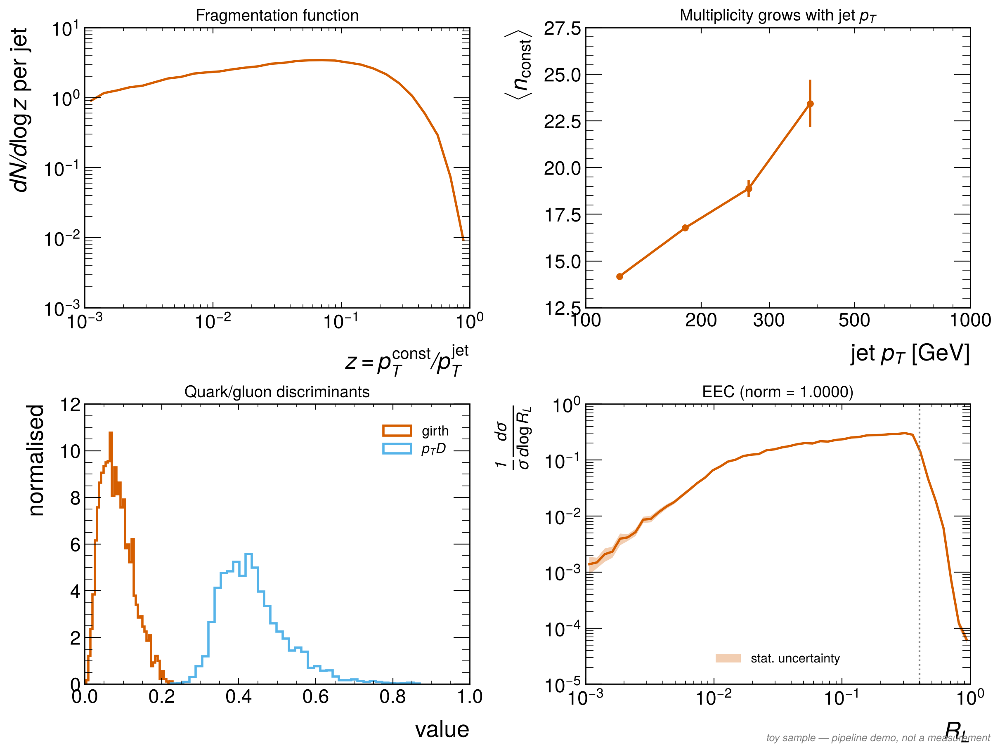
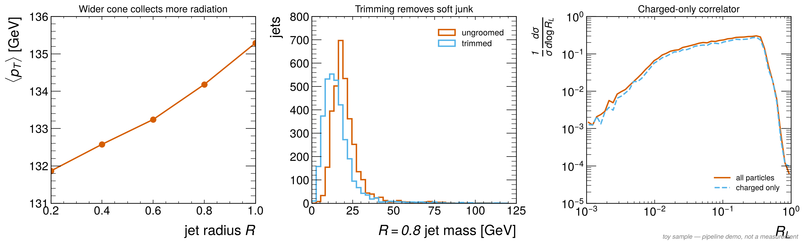
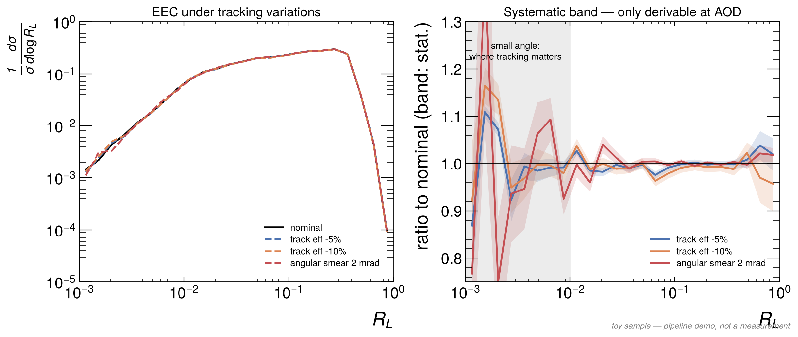

# One analysis per tier — results

Each data tier gets the analysis its information content actually permits, run end to end
on a common sample.

```bash
python src/tier_analyses.py --n-events 2000 --seed 12345
python src/tier_analyses.py --tier miniaod          # one tier only (same sample)
```

> **Input is synthetic** (`src/toy_generator.py`). Shapes are qualitatively right and every
> observable moves in the correct direction, but there is no matrix element, no parton shower
> and no hadronisation model. Nothing below is a measurement — this validates the *pipeline*.
>
> Every number carries its statistical uncertainty, and where the generator knows the answer
> it is printed next to the measurement (a closure test). `tests/test_tier_numbers.py` pins
> every number on this page; `requirements-lock.txt` is the environment that produced them.

---

## NanoAOD — jet four-vectors only



| quantity | result | generator truth |
|---|---|---|
| jets (pT > 100 GeV, \|η\| < 2.5) | 3237 | |
| spectrum index n, dN/dpT ~ pT⁻ⁿ | **5.04 ± 0.07** | 5.08 ± 0.07 on the jet axes; hard-scatter input 5.0 |
| dijet χ, test against flat | χ²/ndf = 21.8/14 | flat at generation |
| R₃₂ = N(≥3 jets)/N(≥2 jets) | **0.151 ± 0.008** | 0.158 ± 0.008 |

**Inclusive jet spectrum.** An unbinned maximum-likelihood fit (`jeteec.stats.power_law_index`)
returns n = 5.04 ± 0.07. That agrees with the generated hard-scatter index of 5.0 and with the
same fit on the generator's own jet axes: reconstruction preserves the power law within the
precision of 3237 jets.

> **Correction.** This page used to report n = 4.85 and explain the 3% deficit as threshold
> migration and acceptance, "what unfolding corrects". The deficit came from the estimator: an
> unweighted least-squares line through log(counts), restricted to bins with more than four
> entries. Sparse high-pT bins only pass that cut when they fluctuate up, which flattens the
> fit. The same jets give 5.00 ± 0.08 with Poisson weights and 5.04 ± 0.07 unbinned.
> `tests/test_stats.py` checks the new estimator for bias.

**Dijet angular distribution.** χ = exp|y₁−y₂| of the two leading jets is flat for
Rutherford-like t-channel exchange, which is what the generator draws. Against a flat line,
χ²/ndf = 21.8/14: consistent with flat at this sample size. The |η| < 2.5 acceptance should
deplete the highest-χ bin by about 10% (estimated from the generator's boost distribution) —
too little to resolve with 1207 pairs.

> **Correction.** The earlier "flat to 16% RMS, residual structure from the acceptance" paired
> whichever two jets fastjet listed first. fastjet does not order jets by pT, so in every event
> with a third jet above 100 GeV (71 events) the pair was the two softest jets. It also used
> pseudorapidity instead of rapidity. With the leading pair, χ²/ndf drops from 32.8/14 to
> 21.8/14.

**Jet multiplicity ratio.** R₃₂ = 0.151 ± 0.008 with a 60 GeV counting threshold. The same
count on the generator's jet axes gives 0.158 ± 0.008, so reconstruction closes. The generator
adds a third jet to 18% of events; the threshold and acceptance bring that down to the
truth-level 0.158. In real data this ratio is αs-sensitive — each extra jet costs one power of
αs.

**Verdict:** a complete QCD measurement is reachable with nothing but uproot and jet
four-vectors. Start here.

---

## PFNano — jets plus their constituents



| quantity | result |
|---|---|
| ⟨n_constituents⟩ | 14.8 |
| multiplicity growth | 14.2 → 23.4 over pT 122 → 384 GeV |
| ⟨girth⟩ | 0.0837 |
| ⟨pTD⟩ | 0.4374 |
| EEC normalisation | **1.000000** ✅ |
| EEC statistical error at the peak | 2.7% |

**Fragmentation function D(z).** The steeply falling z = pT_const/pT_jet spectrum is the
direct statement that jets are dominated by soft particles — a handful of hard constituents
and a long tail of soft ones.

**Multiplicity vs jet pT.** Grows logarithmically, as QCD's soft-gluon emission requires.

**Girth and pTD.** The two classic quark/gluon discriminants, computable from constituents
alone. Gluon jets are broader (larger girth) and share momentum more evenly (smaller pTD).

**EEC.** Normalisation is exactly 1.000000, which is the pipeline's own unit test: the pT
weights must sum to unity per jet, and any deviation means the constituent collection or the
normalisation is wrong before any physics is attempted. The band in the figure is the
statistical uncertainty from the jet-to-jet spread (`eec(..., return_errors=True)`); pairs
inside one jet are correlated, so counting pairs would understate it.

**Verdict:** all of jet substructure opens up. This is the working tier for the project.

---

## MiniAOD — every candidate in the event



| quantity | result |
|---|---|
| candidates kept | 159957 / 159957 (all) |
| per-jet pT gain, R = 0.4 → 1.0 (matched jets, \|η\| < 2) | **+3.01 ± 0.10 GeV**, median +1.99 GeV |
| … predicted from the generated underlying event | +2.12 GeV |
| R = 0.8 jet mass, ungroomed → trimmed | 20.58 → **15.82 GeV** (−23.1%) |
| charged fraction of jet pT | 0.619 |
| EEC, packed vs unpacked | ≤ 1.7% per bin above R_L = 5×10⁻³, up to 35% in single bins below |
| empty EEC bins below R_L = 5×10⁻³ | unpacked 0, MiniAOD 0, hypothetical 10⁻³ grid 4 (of 12) |

**Packing as CMS does it.** `compress()` follows CMSSW's `PackedCandidate`
(`DataFormats/PatCandidates/src/PackedCandidate.cc`): every PF candidate is kept, η and φ are
stored as 16-bit integers over ±6.0 and ±3.2 (steps of 1.8×10⁻⁴ and 9.8×10⁻⁵), pT and mass as
16-bit floats. Check the constants against the CMSSW release of the data you use.

> **Correction.** The earlier toy MiniAOD dropped every candidate below 0.3 GeV and stored
> angles on a 10⁻³ grid. MiniAOD keeps all PF candidates (Petrucciani, Rizzi, Vuosalo,
> arXiv:1702.04685), and its angular step is 5–10× finer. The "4 of 12 empty EEC bins" quoted
> as the quantitative case for AOD came from that coarse grid, not from MiniAOD.

**Radius scan.** Reclustering the same events at larger R raises each jet's pT. Matching every
R = 0.4 jet to its R = 1.0 counterpart gives a gain of +3.01 ± 0.10 GeV. The underlying event
the generator put in predicts 2.12 GeV: its pT density times the extra area, weighted by
cos Δφ because a particle at Δφ from the axis adds pT·cos Δφ to the jet. The median gain
(+1.99 GeV) sits on that prediction; the mean is pulled up by the 1.2% of jets that swallow a
neighbouring jet at R = 1.0. `tests/test_tier_numbers.py` checks the UE part directly:
switching the UE off removes 2.2 GeV of gain, within 8% of the prediction. **This is impossible
at PFNano**, which stored only what was already inside R = 0.4.

**Trimming.** Reclustering R = 0.8 constituents into kT R = 0.2 subjets and dropping those
below 5% of the jet pT removes 23.1% of the jet mass. That removed mass is soft contamination,
not hard substructure — which is exactly why grooming exists. (It was 18.8% while the toy
MiniAOD threw away the soft candidates trimming is meant to remove.)

**Charged-only correlator.** Charged particles carry 62% of the jet pT, and the charged-only
EEC tracks the all-particle one. Worth doing for real because tracks have far better angular
resolution than calorimeter deposits. The charge comes straight out of the clustering: fastjet
returns every field of the input records on the constituents.

**Does packing hurt the EEC?** Barely, and only at the smallest angles. Above
R_L = 5×10⁻³ the packed and unpacked EEC agree to 1.7% per bin. Below about 3×10⁻³ the η step
is as wide as a log bin (1.5×10⁻⁴ at R_L = 10⁻³), so pairs hop between neighbouring bins:
single bins move by up to 35% (2.5σ in one bin) and none empties. Wider bins there remove the
effect. A hypothetical 10⁻³ grid would empty 4 of 12 bins. The toy has perfect detector
resolution; in real data the tracker's and calorimeters' angular resolution enters at these
angles too.

---

## AOD — full precision and tracking systematics



| variation | small angle (R_L < 0.01) | large angle (R_L > 0.1) | jets surviving |
|---|---|---|---|
| track efficiency −5% | −0.8 ± 1.6% | +0.8 ± 0.7% | 2945 |
| track efficiency −10% | +1.4 ± 2.1% | −1.1 ± 1.2% | 2679 |
| angular smear 2 mrad | −1.5 ± 3.8% | +0.5 ± 0.3% | 3239 |

Uncertainties are statistical, from a Poisson bootstrap over events that reweights the nominal
and the varied sample together; they share events, so most of the noise cancels in the ratio.
The efficiency variations are nested: one random number per particle decides its fate in
every variation, so the −10% variation loses the −5% tracks plus more.

**No variation is resolved.** The largest small-angle shift is 0.7σ. With 2000 events the
statistical precision of the small-angle EEC is 1.6–3.8%, larger than anything these
variations do. That is expected for this toy: charge is assigned independently of kinematics,
so dropping tracks at random removes a representative subset, and the per-jet-normalised EEC
barely changes shape. Resolving percent-level tracking effects needs an order of magnitude
more events — or a generator in which charged and neutral particles differ, as they do in
real jets.

> **Correction.** This page used to read physics into these shifts ("the shifts are small —
> and that is a physics result"; "angular resolution acts precisely where the distribution is
> steepest"). The old numbers (−0.9%, +1.9%, +2.0% at small angle) had no uncertainties; with
> them they were within 1.1σ of zero, and the sign flip between −5% and −10% efficiency was
> noise.

**The selection effect is larger than the shape effect.** At −10% tracking efficiency the jet
count falls from 3237 to 2679 (−17%): losing tracks lowers reconstructed jet pT and pushes jets
below the 100 GeV threshold. In a real analysis that migration, not the shape distortion,
would dominate the systematic.

**Why this needs AOD.** Every number in the table required varying tracking *before*
reconstruction. At MiniAOD and above, the tracking is baked in and these variations cannot be
made at all.

---

## RECO

Not released as Open Data, ~3 MB/event, contents are hits, clusters and reconstruction
intermediates. The physics it enables is detector physics — calibration, alignment, tracking
efficiency from first principles. **Nothing to run for this project.**

---

## Bugs found while building this

### fastjet silently mis-clusters non-contiguous input (fastjet ≤ 3.5.1.4)

Reclustering the constituents of R = 0.8 jets into subjets for trimming gave subjet sums that
missed the parent jet by up to **168 GeV in pT and 502 GeV in mass** when first seen — no
exception, no warning, and the first clustering pass looked fine.

The cause was first recorded as "extra fields such as `charge` in the input record", because
stripping the record to four fields made the error go away. That was wrong. Rerun on the
current code with fastjet 3.5.1.4, the version current when the bug appeared (2000 events,
seed 12345):

| input to the reclustering | max \|subjet sum − jet\| (pT / mass) |
|---|---|
| constituents as fastjet returned them, after the acceptance cut — with or without `charge` | 725 GeV / 1480 GeV |
| the same, after `ak.to_packed` (charge kept) | 2×10⁻¹³ GeV / 3×10⁻¹¹ GeV |

fastjet ≤ 3.5.1.4 (tested 3.4.3.1, 3.5.1.0, 3.5.1.4) misreads an awkward array whose sublists
are not stored back to back in memory — what you get after selecting or reordering the
constituents fastjet itself returns. The old `four()` cured it only because re-zipping makes a
packed copy. fastjet 3.5.1.5 fixed it upstream; the awkward version does not matter.

Guards now in place: every call into fastjet goes through `jeteec.jets.clusterable`
(`ak.to_packed`), the requirements ask for `fastjet>=3.5.1.5`, and `tests/test_jets.py` fails
on 3.5.1.4 when the guard is removed.

### Jets are not pT-ordered

fastjet returns jets in no particular order. Code that took `jets[:, 0]` and `jets[:, 1]` as
the leading pair computed χ from the wrong pair in every event with a third jet.
`jeteec.jets.cluster` now sorts by pT.

### ΔR re-matching picked the wrong constituents

Because the old guard stripped `charge` before clustering, charge was re-attached by taking all
particles within ΔR < R of the jet axis. On the MiniAOD sample of the time (seed 12345) that
disagreed with the clustering for 102 of 3212 jets: anti-kT jets that overlap are not circles,
and fastjet measures distance in rapidity, not pseudorapidity. Since fastjet carries extra
fields through, the matching is gone.

---

## Summary

| | NanoAOD | PFNano | MiniAOD | AOD |
|---|---|---|---|---|
| what was run | spectrum, χ, R₃₂ | D(z), multiplicity, girth/pTD, EEC | R-scan, trimming, charged-only | tracking systematics |
| headline number | n = 5.04 ± 0.07 (input 5.0) | EEC norm = 1.000000 | trimming removes 23.1% of the mass | no shift resolved (≤ 0.7σ) |
| enables | QCD measurement | substructure | jet definition freedom | systematics |
| needs CMSSW | no | to produce | yes | yes |
